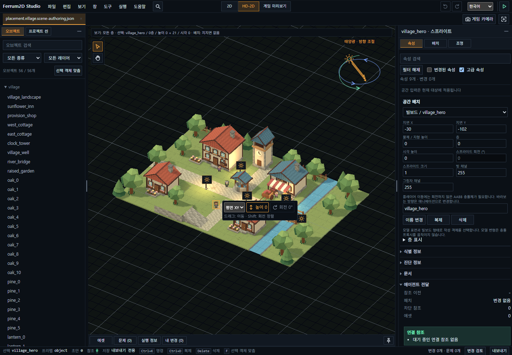
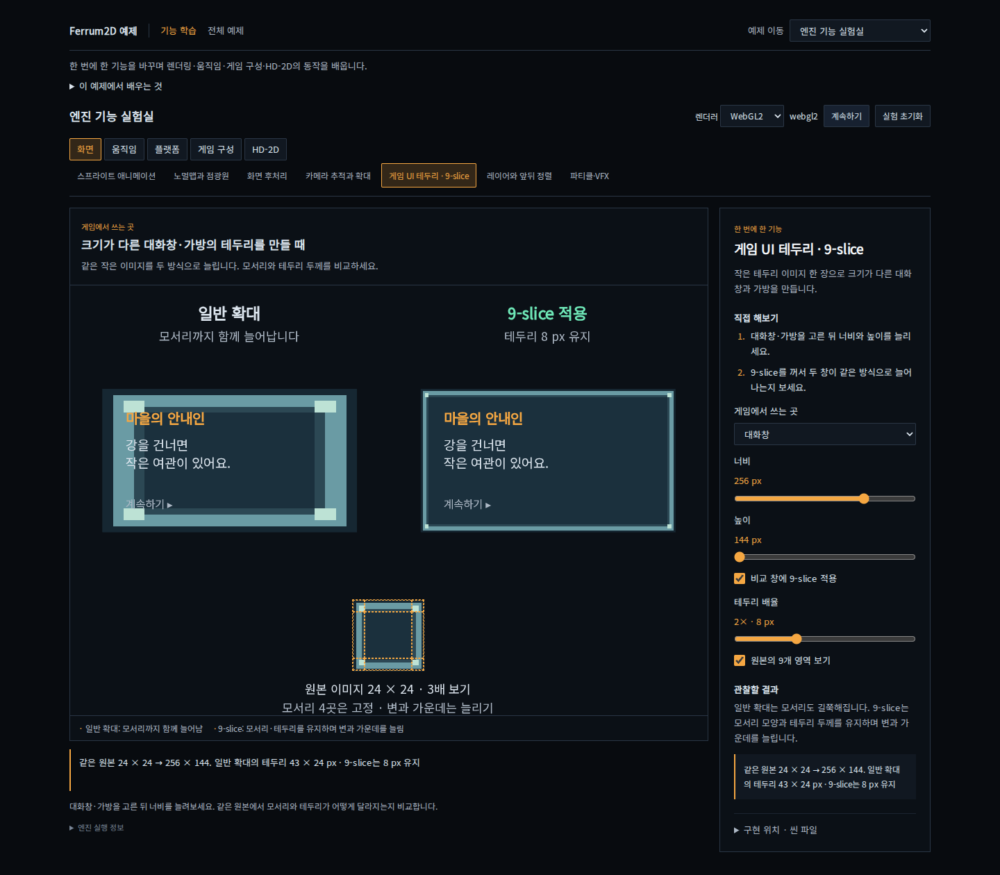
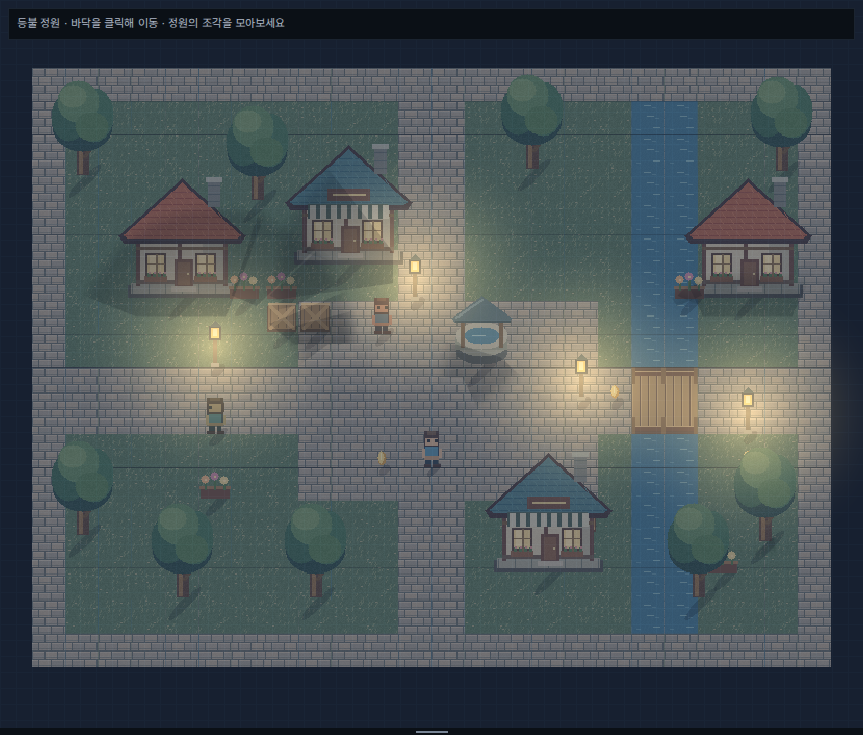
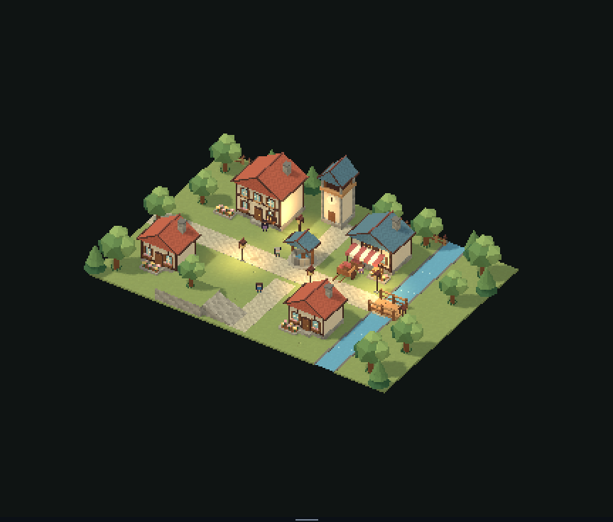
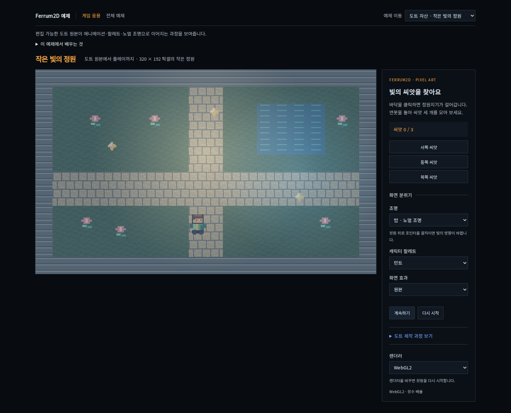
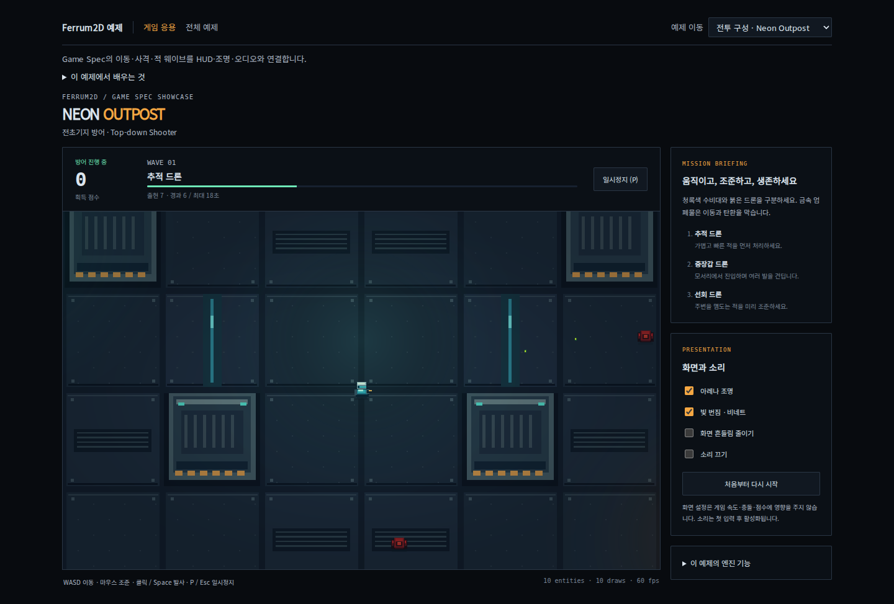
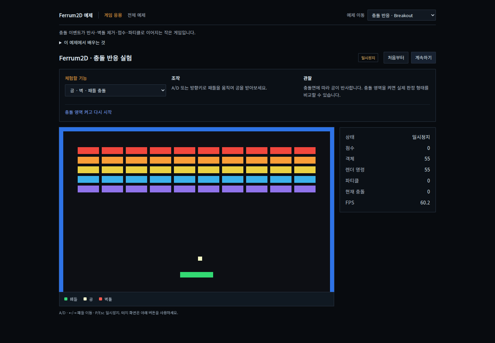
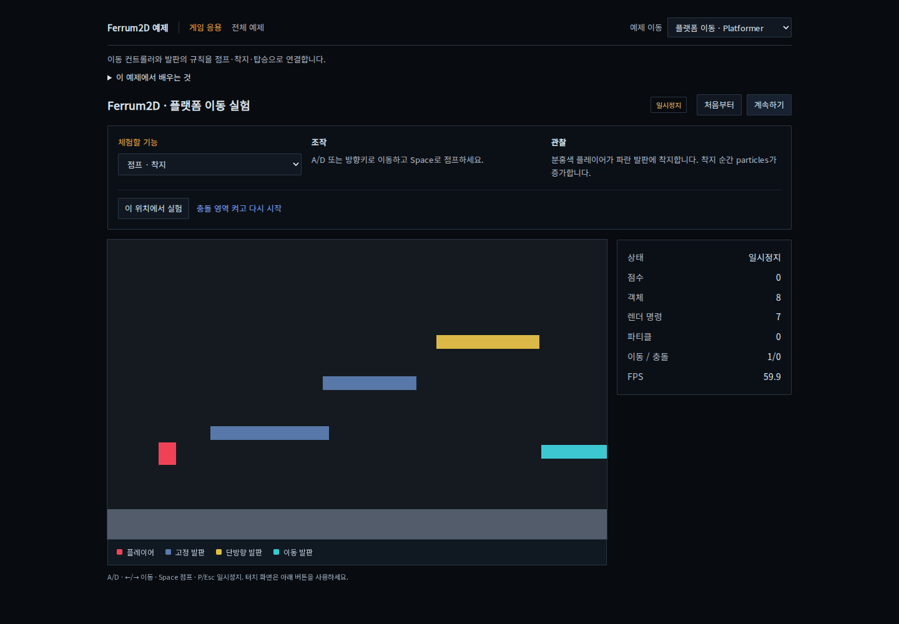
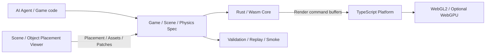

# Ferrum2D

[한국어](README.md) · English

**An AI agent-first 2D and HD-2D web game engine.**

Rust and WebAssembly run the game simulation. TypeScript connects browser APIs, assets, input, audio, and GPU rendering.
Agents edit specifications and code; the Scene/Object Placement Viewer helps people inspect placement and runtime results.

[Try the demos](https://silbaram.github.io/ferrum2d/) · [Features](#engine-capabilities) · [Examples](#example-gallery) · [Quickstart](docs/en/engine/developer-quickstart.md) · [English docs](docs/en/README.md) · [GitHub Releases](https://github.com/silbaram/ferrum2d/releases)



This is a real browser capture of the viewer with example village content.

> **Status:** The MVP baseline is complete; commercial product features are in development.
> Source packages use version `0.1.0`. Development-source capabilities can differ from released beta packages.
> Check the types and documentation for the installed release.

## Try individual engine features

The [**Engine Feature Lab**](https://silbaram.github.io/ferrum2d/starter-runtime/) provides **26 independent experiments**.
Each experiment connects controls and visible results with implementation APIs.



| Interest | Topics | Try it |
| --- | --- | --- |
| Rendering | Animation, normal lighting, post-processing, 9-slice, layers, particles | [9-slice](https://silbaram.github.io/ferrum2d/starter-runtime/?feature=nine-slice) · [Lighting](https://silbaram.github.io/ferrum2d/starter-runtime/?feature=lighting) |
| Movement and collision | Navigation, physics materials, cameras, tile collision | [Navigation](https://silbaram.github.io/ferrum2d/starter-runtime/?feature=navigation) · [Materials](https://silbaram.github.io/ferrum2d/starter-runtime/?feature=physics) |
| Game progression | Scene transitions, interaction, saving, dialogue/quests, projectiles, cutscenes | [Dialogue](https://silbaram.github.io/ferrum2d/starter-runtime/?feature=dialogue) · [Save/load](https://silbaram.github.io/ferrum2d/starter-runtime/?feature=save-load) |
| Platform and accessibility | Spatial audio, input switching, HUD/localization/accessibility | [Input](https://silbaram.github.io/ferrum2d/starter-runtime/?feature=input) · [Audio](https://silbaram.github.io/ferrum2d/starter-runtime/?feature=audio) |
| Content integration | Asset loading, level streaming, parent/child attachments | [Streaming](https://silbaram.github.io/ferrum2d/starter-runtime/?feature=streaming) · [Attachments](https://silbaram.github.io/ferrum2d/starter-runtime/?feature=attachments) |
| Spatial gameplay | HD-2D movement, combat AI, lighting/shadows/fog, terrain destruction | [HD-2D movement](https://silbaram.github.io/ferrum2d/starter-runtime/?feature=hd2d-movement) · [Terrain destruction](https://silbaram.github.io/ferrum2d/starter-runtime/?feature=destructible-terrain) |

[Full English feature guide](docs/en/engine/showcase-hub.md) · [Seven advanced physics scenarios](https://silbaram.github.io/ferrum2d/physics-sandbox/)

## Engine capabilities

This table describes the **current development source**. Detailed contracts define supported inputs, limits, and opt-in requirements.

| Area | Features | Reference |
| --- | --- | --- |
| Data and behavior authoring | Game/Scene/Physics Specs, prefabs/ObjectDefinitions, Behavior Recipe/FSM execution, agent patches and handoff | [Authoring API (Korean)](docs/engine/public-api/authoring.md) |
| Runtime and scenes | Rust/Wasm state and entities, declarative scenes/prefabs, transitions/fades, snapshots and progress persistence | [Core API (Korean)](docs/engine/public-api/core.md) |
| 2D rendering and animation | Sprite batches, atlases, tilemaps, layers/depth sorting, 9-slice, bitmap text, render textures, per-frame durations, reverse/ping-pong playback and events | [Presentation (Korean)](docs/engine/data-scene-presentation.md) |
| Pixel presentation | Fixed resolution, integer scaling, letterboxing, screen-space snapping, atlas edge protection, palette swaps, quantization, dithering and scanlines | [Pixel effects (Korean)](docs/engine/public-api/core.md#도트-후처리) |
| HD-2D | Static GLB/glTF models, terrain, slopes, elevation, floors/bridges, billboards, orthographic/perspective cameras, picking, chunks and LOD | [Spatial Scenes (Korean)](docs/engine/data-scene-spatial.md) |
| Lighting and shadows | Sprite/model normal maps, point/spot/sun/hemisphere lights, shadow filtering and bias, ground shadows from authored building volumes | [Spatial environment (Korean)](docs/engine/data-scene-spatial.md#광원-작성과-씬-효과) |
| Screen effects | Bloom, CRT, vignette, fade/glitch; spatial HDR, AO, fog, depth of field, exposure, tone mapping and grading | [Core API (Korean)](docs/engine/public-api/core.md) |
| Gameplay | Movement/navigation, interactions/triggers, dialogue/quests, projectiles/weapons, combat AI, spawn prefabs, parent/child attachments and cutscenes | [Scene Authoring (Korean)](docs/engine/data-scene-authoring.md) |
| Physics | Bodies/materials/sensors, compound colliders, eight joint types, CCD, raycasts/shape casts, controllers/platforms, floor/height filters and destructible terrain | [Physics Map (Korean)](docs/development/architecture/physics-engine.md) |
| Input and audio | Action bindings/contexts, keyboard, pointer, gamepad, virtual controls, audio policy and spatial audio | [Input (Korean)](docs/engine/input-actions.md) |
| Assets and loading | Atlases, Aseprite/Tiled/LDtk data, trimmed sprite restoration, parallel loading/cancellation/retry/cache, optional KTX2, model caching and level streaming | [Core API (Korean)](docs/engine/public-api/core.md) |
| Scene workspace | Project scene browsing, multiple documents, drag/drop, transforms, Undo/Redo, layers/locks, game cameras, lights, My Changes, handoff and asset usage/catalog cleanup | [Viewer guide (Korean)](apps/placement-viewer/README.md) |
| Tile authoring | Tileset/map imports, author-time autotiling, tile animation with fixed collision, and time-based map previews | [Tile authoring (Korean)](docs/engine/data-scene-authoring.md#작성-시점-오토타일과-맵-미리보기) |
| Pixel authoring | RGBA/indexed palettes, selections/transforms, layer opacity/blending/merge, animation/onion skinning, PNG conversion, normals and GIF/APNG export | [Pixel editor (Korean)](apps/placement-viewer/README.md#내장-도트-제작) |
| Diagnostics and checks | Profiling/frame traces, GPU resource statistics, WebGL2 GPU timing, Wasm memory, spec validation, replay/hash, browser smoke tests, runtime budgets and consumer checks | [Quality API (Korean)](docs/engine/public-api/quality.md) |

### Physics and spatial gameplay

- Combine AABB, circle, capsule, oriented box, convex polygon, edge, chain, and compound colliders. Sensors, collision masks, and floor/height filters are available.
- Configure static, kinematic, or dynamic bodies with forces, impulses, rotation, friction, restitution, and sleeping. Joint types are distance, rope, spring, pulley, revolute, prismatic, weld, and gear.
- Connect slopes, steps, bridge underpasses, floor links, lifts/moving platforms, obstacle avoidance, and multi-floor combat AI through authored scene data.
- Edit an alpha mask to update terrain rendering and the affected collider chunks.

Generic rigid-body simulation uses explicit automatic-stepping configuration or manual steps.
The [native runtime (Korean)](docs/engine/data-scene-native-runtime.md) and [spatial contract (Korean)](docs/engine/data-scene-spatial.md)
define how rendering, physics elevation, and persisted progress relate.

### Lighting and cameras

- **2D:** Normal maps provide surface-dependent light response. Point-light occlusion and sun ground shadows are handled separately; buildings can author footprint, wall, and roof volumes for ground shadows.
- **HD-2D:** Point/spot/sun and sky/ground hemisphere lights, hard/PCF shadows, bias controls, HDR, bloom, AO, fog, depth of field, and grading.
- **Game framing:** Navigate with the editor camera, then author the game camera's position, direction, angle, zoom/framing and inspect it in Game Preview.

WebGL2 is the default renderer. WebGPU is optional, with feature-specific support conditions.
Consult [Spatial Scenes (Korean)](docs/engine/data-scene-spatial.md) for light/shadow budgets, effect composition, and backend limits.

### Scene and asset workspace

- Browse project scenes in multiple documents, drag assets into the viewport, and inspect position, elevation, rotation, scale, drawing order, and collision overlays.
- Arrange the menu bar, `Ctrl+K`/`Cmd+K` command search, contextual shortcut hints, resizable/collapsible panels, and bottom drawer. English and Korean UI are available.
- Review object-level before/after values in **My Changes**. Select a change to focus its object and pass patches/handoff data to an agent.
- Search assets and trace their usage. Imports, reimports, normal bindings, and disk catalog cleanup each use their documented validation and storage workflow.
- Use **Help → Versions and updates** to check public releases. Supported desktop environments handle project engine updates separately from signed application updates.

Built-in browser examples are **export only**. File saving uses permissions provided by the active host.
Game Preview runs the Scene Authoring runtime. See the [viewer guide (Korean)](apps/placement-viewer/README.md).

### Built-in pixel editor

- Draw, fill, select, transform, and edit palettes; use dithering, gradients, and outlines.
- Work with RGBA/indexed palettes, layer opacity, normal/multiply/screen blending, and layer merges.
- Edit up to 64 frames with durations, tags, reverse/ping-pong playback, and onion-skin ranges; connect the result to sprite animation.
- Import an external PNG through drag/drop or the clipboard, crop/resize it, reduce colors or apply a palette, and open it as a document or layer.
- Export editable sources, PNG sheets, GIF, or APNG. Supported hosts provide project saving and recovery. Install the optional normal generator to create color/normal pairs and apply them to scenes.

See [pixel editing and saving conditions (Korean)](apps/placement-viewer/README.md#내장-도트-제작).

## Example gallery

Follow **focused features → deeper physics → game applications** in the [hub](https://silbaram.github.io/ferrum2d/).
Game and lab examples share navigation and show instructions, observations, and related experiments. Authoring tools have a separate section and retain their workspace UI.
Minimal and legacy integrated demos remain reference/test fixtures outside the main catalog. See [example roles and local execution](examples/README.md).

| 2D Lantern Garden | HD-2D Village |
| --- | --- |
|  |  |
| Tilemaps, pixel characters, lights, shadows, click-to-move navigation, and collection. | Static GLB buildings, terrain, 2D characters, floors, cameras, and lighting. |

**Little Garden of Light** combines editable pixel sources, walking/collection, normal lighting, palettes, and screen effects.



**Neon Outpost · Top-down Shooter** combines a pixel arena, three enemy wave types, native score/wave HUD, pause/restart controls, lighting/post-processing settings, and mobile movement.



| Collision and reflection | Jumping and platforms |
| --- | --- |
|  |  |
| Ball, paddle, bricks, hit events, and particles. | Landing, one-way platforms, and moving platforms. |

Both examples include pause/restart, touch controls, and a color legend. The [Physics Lab screenshot](docs/development/quality/screenshots/physics-lab.png) shows scenario bodies, materials, contacts, and single-step controls.

These are real browser captures, not visual mockups. Garden/village previews were paused for consistent framing.
The artwork and gameplay are example content built on engine APIs. [Capture details (Korean)](docs/development/quality/screenshots/README.md).

### Run examples locally

After [building the source](#build-the-engine-source), run a command from the repository root and open the Vite address printed in its terminal.

| Example | Command | Source |
| --- | --- | --- |
| Feature Lab, 26 independent experiments | `pnpm dev:starter-runtime` | [starter-runtime](examples/starter-runtime/) |
| 2D garden / HD-2D village | `pnpm dev:placement-viewer`, then `?scene=garden` / `?scene=village` | [placement-viewer](apps/placement-viewer/) |
| Top-down Shooter | `pnpm dev:topdown` | [topdown-shooter](examples/topdown-shooter/) |
| Physics Sandbox | `pnpm dev:physics-sandbox` | [physics-sandbox](examples/physics-sandbox/) |
| Breakout | `pnpm dev:breakout` | [breakout](examples/breakout/) |
| Platformer | `pnpm dev:platformer` | [platformer](examples/platformer/) |
| Little Garden of Light | `pnpm dev:pixel-art` | [pixel-art](examples/pixel-art/) |

Game Preview uses the scene's authored camera and supported behaviors. An external project's arbitrary TypeScript entrypoint or custom HUD runs through that project's own development server.
The [English feature guide](docs/en/engine/showcase-hub.md) connects all examples to their topics.

## Development workflow and ownership



Rust owns game state, simulation, collision, scene logic, and render commands, including quest/dialogue progress and terrain masks.
TypeScript connects browser APIs, GPU rendering, input/audio/assets, content validation, and UI.
Frame data crosses the boundary in bulk buffers. Standalone native-backed dialogue/terrain helpers require `await initializeFerrumWasm()` before construction.

### Public package entrypoints

| Import | Purpose |
| --- | --- |
| `@ferrum2d/ferrum-web/core` | Runtime and platform APIs; the main product contract |
| `@ferrum2d/ferrum-web/authoring` | Scene, prefab, and Behavior Recipe authoring primitives |
| `@ferrum2d/ferrum-web/starter-scenes` | Starters used by generated projects and checks |
| `@ferrum2d/ferrum-web/labs` | Optional features with explicit prerequisites |
| `@ferrum2d/ferrum-web/quality` | Profiling, replay, smoke tests, reports, and runtime budgets |

The root aggregate remains a compatibility entrypoint. Source paths, build internals, and generated Wasm bindings are private.
See [support tiers and import policy](docs/en/engine/public-api.md).
General-purpose visual editing of Behavior Recipe bodies or FSM/action graphs, multiplayer, full game-loop workers/Wasm threads,
complex physics extensions, and skeletal animation require separate design and approval.

## Start a game project

Choose an installable `ferrum2d-create-game-<version>.tgz` asset from a [GitHub Release](https://github.com/silbaram/ferrum2d/releases).
Node.js 22 is recommended; a project using the distributed engine does not need Rust.

```bash
ferrum_cli_url="<create-game .tgz download URL from the selected release>"
npx --yes --allow-remote=root "$ferrum_cli_url" my-game
cd my-game
npm install
npm run dev
npm run ferrum:check
```

The generator pins package URLs from the selected release. Use `npm run ferrum:agents` to install the project's agent instructions explicitly.
The [Developer Quickstart](docs/en/engine/developer-quickstart.md) covers templates, project files, and deployment checks.
For setup without generating a game, see the [AI installation guide (Korean)](docs/engine/ai-agent-install.md).

| Package | Responsibility |
| --- | --- |
| `@ferrum2d/ferrum-web` | Rust/Wasm engine and browser runtime |
| `@ferrum2d/authoring-viewer` | Shared placement, asset, and handoff helpers |
| `@ferrum2d/create-game` | Game project generator |
| `@ferrum2d/agents` | Consumer agent/skill/command installer |

The full desktop Placement Viewer is distributed separately from the helper package and includes its preview engine.
Check the selected release's actual attachments for available OS installers. [Distribution procedure (Korean)](docs/development/operations/github-release.md).

## Build the engine source

Install Rust stable, `wasm32-unknown-unknown`, wasm-pack, Node.js 22, and pnpm 10.8.0.

```bash
git clone https://github.com/silbaram/ferrum2d.git
cd ferrum2d
rustup default stable
rustup target add wasm32-unknown-unknown
cargo install wasm-pack
corepack enable
corepack prepare pnpm@10.8.0 --activate
pnpm install
pnpm build
pnpm dev:starter-runtime
```

Use `pnpm dev:placement-viewer` for scene and pixel authoring.
For an external npm game project, `pnpm engine:local --project /path/to/my-game` builds, packages, installs, and validates the local engine.
Read the [installation and recovery contract (Korean)](docs/development/operations/local-engine-install.md) before using that workflow.

## Verify changes

```bash
pnpm lint
pnpm test
pnpm build
pnpm validate:docs-links
pnpm validate:public-api-surface
```

Choose browser smoke checks for the changed feature. Package changes use `pnpm package:check`;
generated-project changes use `pnpm package:consumer-smoke`. The full regression aggregate is `pnpm smoke:check`.
See [Smoke Check (Korean)](docs/development/quality/smoke-check.md) for maintained commands and pass conditions.

`Language boundaries` runs on PRs and pushes to `main` to check ownership rules, the Wasm ABI, and SDK regressions.
Full `CI` and `Pages` deployment are manually dispatched. Build the local site with `pnpm build:pages` and check it with `pnpm validate:pages-artifact`.

## Documentation and source map

| Location | Responsibility |
| --- | --- |
| `crates/ferrum-core/` | Rust simulation and Wasm bridge |
| `packages/ferrum-web/` | TypeScript browser runtime |
| `packages/ferrum-authoring-viewer/` | Shared authoring helpers |
| `packages/create-game/`, `packages/agents/` | Project generation and consumer AI instructions |
| `apps/placement-viewer/`, `apps/placement-viewer-desktop/` | Web and desktop authoring tools |
| `examples/` | Feature Lab, focused physics scenarios, and genre examples |
| `docs/`, `scripts/` | Usage contracts, architecture, validation, planning, and build tools |

Start with the [English documentation index](docs/en/README.md), [User Guide](docs/en/engine/user-guide.md),
[Feature Guide](docs/en/engine/showcase-hub.md), or [Public API](docs/en/engine/public-api.md).
The English index identifies detailed references that are still in Korean. Release history is in [CHANGELOG](CHANGELOG.md).

## License

Dual-licensed under `MIT OR Apache-2.0`. See [LICENSE](LICENSE).
