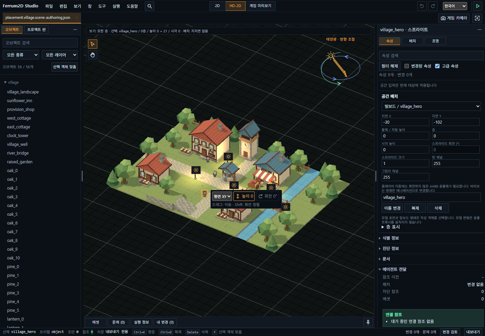
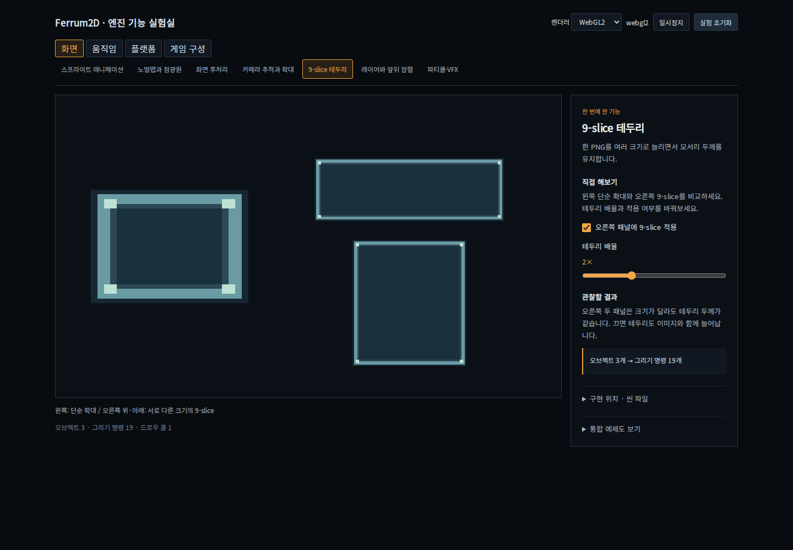
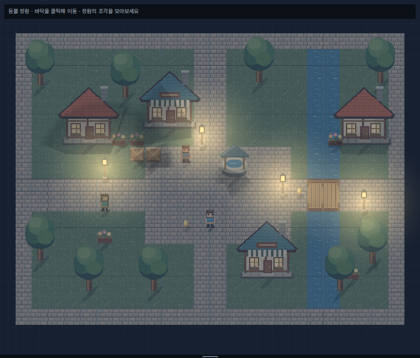
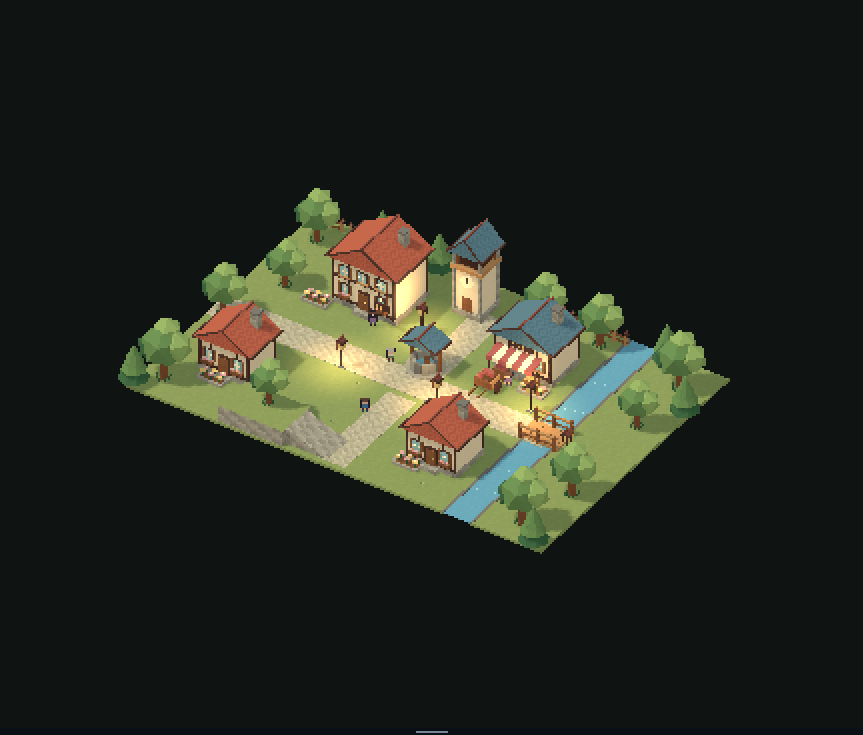
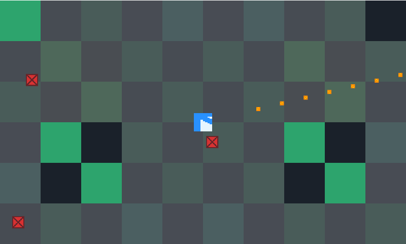
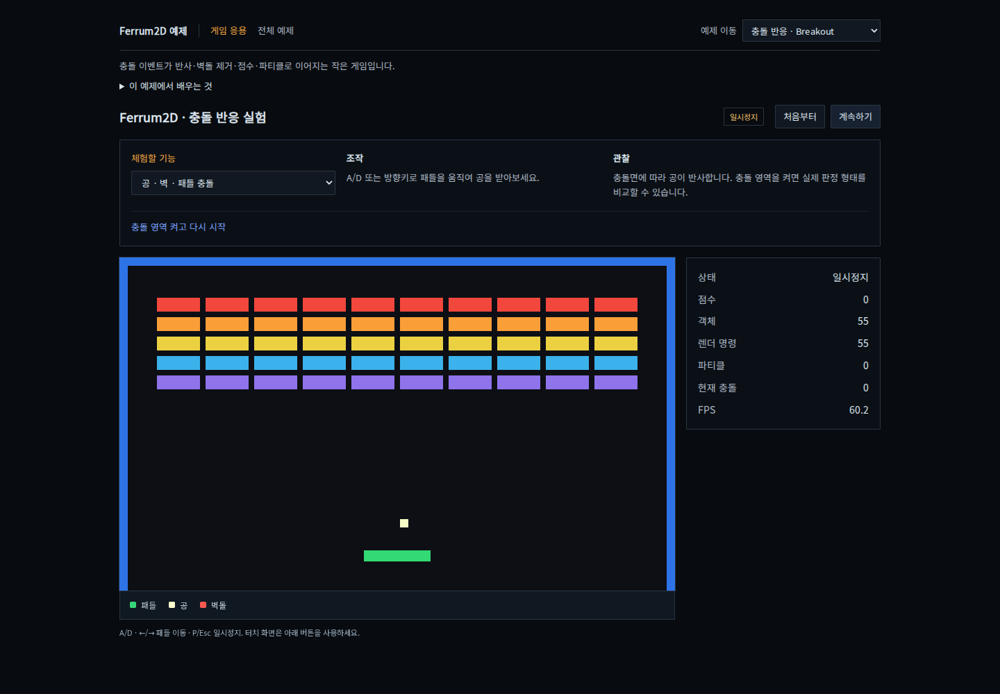
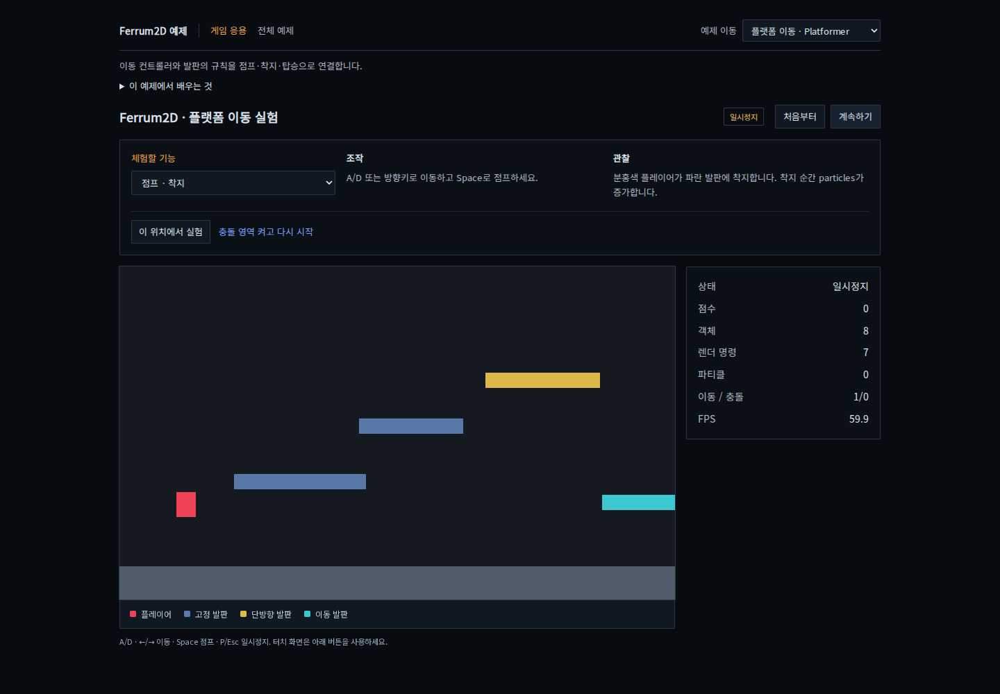
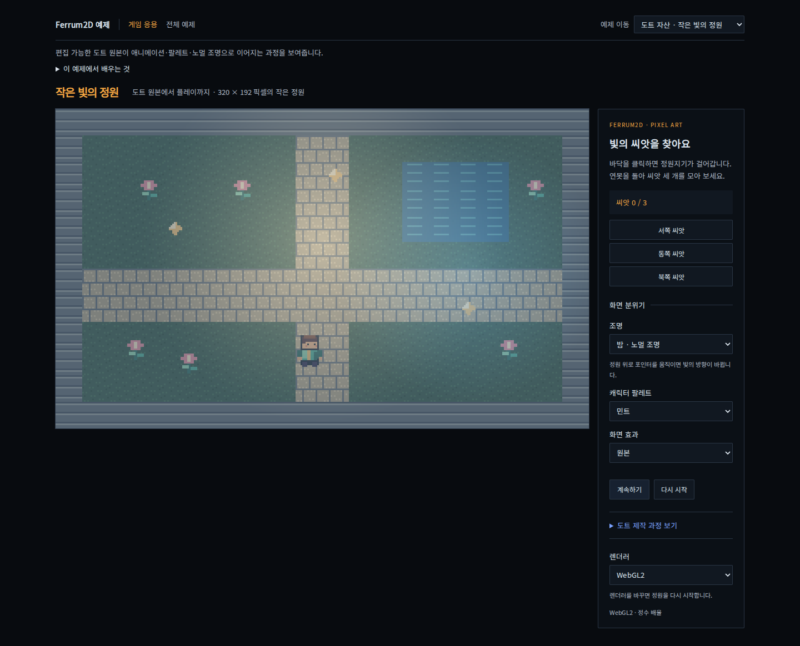
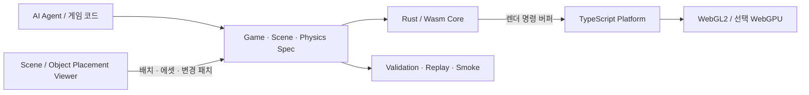

# Ferrum2D

한국어 · [English](README.en.md)

**AI agent-first 2D · HD-2D 웹 게임 엔진**

Rust / WebAssembly로 게임을 실행하고, TypeScript와 WebGL2로 브라우저에 그립니다.
AI agent가 데이터와 코드를 수정하고, Scene/Object Placement Viewer에서 배치와 실행 결과를 확인합니다.

[브라우저에서 체험하기](https://silbaram.github.io/ferrum2d/) · [시작하기](#시작하기) · [기능](#어떤-기능이-있나요) · [예제](#예제-갤러리) · [기능 안내](docs/engine/ai-feature-guide.md) · [문서](docs/README.md) · [GitHub Releases](https://github.com/silbaram/ferrum2d/releases)



*정적 3D 마을과 2D 캐릭터를 함께 배치하는 HD-2D 작업공간. 아래 이미지는 현재 개발 소스를 실제 브라우저에서 실행한 화면입니다.*

> **현재 상태:** MVP 개발 완료, 상용제품 기능 개발 중입니다. 저장소의 package version은 `0.1.0`이며,
> 개발 소스의 기능과 공개된 beta 패키지의 기능은 다를 수 있습니다. 설치 버전의 릴리스 노트와 문서를 함께 확인하세요.

## 기능을 먼저 체험하기

[**엔진 기능 실험실**](https://silbaram.github.io/ferrum2d/starter-runtime/)에서 **31개 기능을 각각 독립된 씬**으로 체험할 수 있습니다.
10개 기능 주제로 탐색하고 2D·HD-2D를 따로 필터링합니다. 물리 심화 7종도 같은 주제에서 바로 엽니다.
게임에서 쓰는 상황·조작 순서·객체 이름표·화면 범례를 따라 결과를 비교합니다.
원본 애니메이션, 카메라 영역, 로딩 상태와 화면 안 대화·HUD를 확인하고 상세 패널에서 설정·구현 API를 읽을 수 있습니다.



| 기능 주제 | 실험 내용 | 바로 체험 |
| --- | --- | --- |
| 조명·그림자 | 2D 노멀·점광원, HD-2D 태양, 실제 캐릭터·나무와 화면 밖 그림자·고정 영역 비교 | [환경](https://silbaram.github.io/ferrum2d/starter-runtime/?feature=hd2d-environment) · [그림자](https://silbaram.github.io/ferrum2d/starter-runtime/?feature=hd2d-shadow-proxy) |
| 물리·충돌 | 재질·충돌체·관절·CCD·공간 질의·지형 파괴 | [실험 열기](https://silbaram.github.io/ferrum2d/starter-runtime/?feature=physics-queries) |
| 카메라·화면 효과 | 추적·확대·흔들림·월드 경계, 후처리·픽셀 정렬 | [실험 열기](https://silbaram.github.io/ferrum2d/starter-runtime/?feature=postprocess) |
| 스프라이트·애니메이션 | 시트·프레임 이벤트·레이어·팔레트·외곽선 | [실험 열기](https://silbaram.github.io/ferrum2d/starter-runtime/?feature=sprite-materials) |
| 맵·공간·이동 | 타일맵·길 찾기·경사·층·발판·부모 연결 | [실험 열기](https://silbaram.github.io/ferrum2d/starter-runtime/?feature=hd2d-movement) |
| 파티클·VFX | 불꽃·먼지·잔상과 방출·수명 | [실험 열기](https://silbaram.github.io/ferrum2d/starter-runtime/?feature=particles) |
| 게임 로직·씬 | 씬 전환·사격·AI·저장·대화·컷신 | [실험 열기](https://silbaram.github.io/ferrum2d/starter-runtime/?feature=scenes) |
| UI·입력 | HUD·다국어·접근성·9-slice·입력 전환 | [실험 열기](https://silbaram.github.io/ferrum2d/starter-runtime/?feature=hud) |
| 오디오 | 음원 위치·거리 감쇠·볼륨 | [실험 열기](https://silbaram.github.io/ferrum2d/starter-runtime/?feature=audio) |
| 에셋·실행 환경 | 로딩·캐시·스트리밍·렌더링 자원 | [실험 열기](https://silbaram.github.io/ferrum2d/starter-runtime/?feature=rendering) |

[전체 기능·조작 안내](docs/engine/showcase-hub.md) · [로컬 실행과 예제 소스](examples/README.md) · [물리 심화 실험 7종](https://silbaram.github.io/ferrum2d/physics-sandbox/)

## 어떤 기능이 있나요?

아래는 **현재 개발 소스**의 기능입니다. 설치한 패키지의 지원 여부와 수치·형식 제약은 각 기준 문서에서 확인합니다.

| 영역 | 제공 기능 | 자세히 보기 |
| --- | --- | --- |
| 데이터 작성·행동 | Game/Scene/Physics Spec, prefab·ObjectDefinition, Behavior Recipe·FSM 실행, agent용 patch·handoff | [Authoring API](docs/engine/public-api/authoring.md) |
| 런타임·씬 | Rust/Wasm 게임 상태·엔티티, 선언형 씬·prefab, 씬 전환·페이드, snapshot·진행 저장/복원 | [Core API](docs/engine/public-api/core.md) |
| 2D 렌더링·애니메이션 | sprite batch·atlas·tilemap, Flat emission·specular·roughness 재질, 레이어·깊이 정렬, 9-slice, bitmap text, render texture, 프레임별 시간·역방향/핑퐁·재생 이벤트 | [표현·애니메이션](docs/engine/data-scene-presentation.md) |
| 픽셀 표현 | 고정 해상도·정수 확대·레터박스·화면 픽셀 스냅, 아틀라스 가장자리 보호, 팔레트 스왑·양자화·디더·스캔라인 | [2D 표시](docs/engine/data-scene-authoring.md) · [도트 후처리](docs/engine/public-api/core.md#도트-후처리) |
| HD-2D 공간 | 정적 GLB/glTF·선택 비금속 specular 재질, 지형·경사·높이·층·다리, billboard, 직교/원근 카메라·picking, 모델 청크·LOD·제출 최적화 | [공간 씬](docs/engine/data-scene-spatial.md) |
| 조명·그림자 | sprite/model normal map, 점광원·스포트·태양광·반구광, 그림자 필터·표면 보정, 건물 입체 도형의 지면 그림자 | [조명·환경](docs/engine/data-scene-spatial.md#광원-작성과-씬-효과) · [지면 그림자](docs/engine/data-scene-presentation.md) |
| 화면 효과 | Bloom·CRT·vignette·fade/glitch, Spatial HDR·AO·안개·피사계심도·노출/톤매핑·색 보정 | [Core API](docs/engine/public-api/core.md) · [Spatial 환경](docs/engine/data-scene-spatial.md) |
| 게임플레이 | actor 이동·길 찾기, 상호작용·트리거, 대화·퀘스트, projectile·weapon·전투 AI·생성 prefab, 부모/자식 연결, 컷신 | [AI 기능 안내](docs/engine/ai-feature-guide.md) · [Scene Authoring](docs/engine/data-scene-authoring.md) |
| 물리·충돌 | 강체·재질·센서·복합 충돌체, 8종 joint, CCD·raycast/shape cast, controller·발판, 층/높이 필터·파괴 지형 | [물리 기능 맵](docs/development/architecture/physics-engine.md) · [Physics Spec](docs/engine/physics-spec.md) |
| 입력·오디오 | action binding·context, 키보드·포인터·gamepad·가상 조작부, 오디오 정책·공간 오디오 | [입력](docs/engine/input-actions.md) · [공간 오디오](docs/engine/public-api/core.md#공간-오디오) |
| 에셋·로딩 | atlas, Aseprite/Tiled/LDtk 데이터 가져오기, trim 복원, 병렬 로딩·취소·재시도·캐시, 선택 KTX2, 모델 캐시·레벨 스트리밍 | [에셋·플랫폼 API](docs/engine/public-api/core.md) |
| 씬 작업공간 | 프로젝트 씬 탐색·다중 문서, drag/drop·변형·Undo/Redo, 레이어·잠금, 게임 카메라·조명 작성, 내 변경·handoff, 에셋 사용처·Catalog 정리 | [뷰어 안내](apps/placement-viewer/README.md) |
| 타일 작성 | 외부 타일셋·맵 가져오기, 작성 시점 오토타일, 타일 애니메이션·고정 충돌·시간별 맵 미리보기 | [타일 작성](docs/engine/data-scene-authoring.md#작성-시점-오토타일과-맵-미리보기) |
| 내장 도트 제작 | RGBA/인덱스 팔레트, 선택·자유 변형, 레이어 합성·불투명도·병합, 애니메이션·어니언, PNG 변환·노멀 생성·GIF/APNG 내보내기 | [도트 편집](apps/placement-viewer/README.md#내장-도트-제작) |
| 진단·검증 | profiler·프레임 기록, GPU 자원 통계·WebGL2 GPU 시간·Wasm 메모리, spec validation·replay/hash·browser smoke·runtime budget·consumer smoke | [검증 기준](docs/development/quality/smoke-check.md) · [Quality API](docs/engine/public-api/quality.md) |

### 물리와 HD-2D 게임플레이

- **충돌 형상:** AABB·원·캡슐·회전 박스·볼록 다각형·edge·chain과 복합 충돌체를 조합합니다. 센서·레이어/category/mask·높이/층 필터를 지원합니다.
- **강체와 연결:** static/kinematic/dynamic body에 힘·충격·회전·마찰·반발·sleep을 적용합니다. distance·rope·spring·pulley·revolute·prismatic·weld·gear joint를 제공합니다.
- **이동과 탐색:** 경사·계단·다리 아래 통과·층 연결·승강/이동 발판, 장애물 우회와 다층 전투 AI를 씬 데이터로 연결합니다.
- **파괴 지형:** alpha mask를 수정하면 텍스처와 영향받은 청크의 충돌체를 갱신합니다.

범용 강체 simulation은 자동 stepping 설정 또는 명시적 수동 step으로 실행합니다.
표시·물리 높이·저장되는 진행 데이터의 범위는 [Native Runtime](docs/engine/data-scene-native-runtime.md)과 [공간 계약](docs/engine/data-scene-spatial.md)을 따릅니다.

### 조명과 카메라

- **2D:** 노멀맵으로 표면 방향에 따른 빛을 표현하고, 점광원별 차폐와 태양광 지면 그림자를 계산합니다. 건물은 바닥·벽·지붕의 도형을 작성해 그림자를 만듭니다.
- **2D 표면 조명 · 개발 소스:** `profile:"lit"`을 선택하면 opaque/cutout sprite의 선형 색에 조도를 곱합니다. 기존 overlay가 기본값이며, 자산 준비와 지원 범위는 [표면 조명 계약](docs/engine/data-scene-presentation.md#flat-2d-표면-조명-개발-소스)을 따릅니다.
- **선형 색공간 · 개발 소스:** `colorManagement:"linear-srgb"`를 양 backend에서 지원합니다. 색·데이터 texture와 alpha를 구분하고 합성 후 한 번 표시 변환합니다. [계약](docs/engine/public-api/core.md#색-공간-관리)을 따릅니다.
- **2D HDR · 개발 소스:** lit의 `hdr` 옵션은 양 backend float16 월드·노출·톤매핑을 지원하며 HUD 경계를 유지합니다. [사용법·비용](docs/engine/data-scene-presentation.md#flat-hdr-개발-소스)을 확인하세요.
- **HD-2D:** 점광원·스포트·태양광·하늘/지면 반구광, hard/PCF 그림자와 bias 보정을 제공합니다. HDR·Bloom·AO·안개·DOF·색 보정을 함께 설정합니다.
- **HD-2D 성분 분리 · 개발 소스:** [선택형 합성](docs/engine/data-scene-spatial.md#선택형-조명-성분-분리-개발-소스)은 AO를 환경광에만 적용해 발광·직접광을 보존하고, 안개·DOF 뒤의 HDR 색을 Bloom 입력으로 사용합니다.
- **게임 구도:** 편집용 카메라로 작업 화면을 탐색하고, 별도의 게임 카메라에 위치·시선·각도·확대/촬영 범위를 작성해 미리보기와 저장에 반영합니다.

WebGL2가 기본 렌더러이며 WebGPU는 지원 환경과 기능 조건에 따라 선택합니다.
조명 수·그림자 예산·효과 합성·backend별 지원 범위는 [공간 씬 문서](docs/engine/data-scene-spatial.md)를 기준으로 합니다.

### 씬·에셋 작업공간

- 프로젝트의 씬을 찾아 여러 문서로 열고, 에셋을 끌어 배치한 뒤 위치·높이·회전·배율·그리기 순서와 충돌 표시를 확인합니다.
- 메뉴바, `Ctrl+K`/`⌘K` 명령 검색, 작업별 단축키, 접기·크기 조절 가능한 패널과 하단 서랍으로 작업공간을 구성합니다. 한국어·영문 UI를 제공합니다.
- **내 변경(My Changes)**에서 오브젝트별 이전/이후 값을 검토하고, agent가 읽을 patch·handoff를 전달합니다. 변경 행을 누르면 해당 객체를 선택합니다.
- 프로젝트 에셋을 검색하고 사용처를 추적합니다. 원본 가져오기·재가져오기·노멀 연결·디스크 Catalog 정리는 각각의 검증·저장 절차를 사용합니다.
- **도움말 → 버전 및 업데이트**에서 공개 릴리스를 확인합니다. 지원하는 데스크톱 환경은 프로젝트 엔진 갱신과 서명된 앱 업데이트를 구분해 처리합니다.

웹 내장 예제는 **내보내기 전용**입니다. 파일 저장은 활성 host가 허용한 범위에서 실행하며,
게임 미리보기는 Scene Authoring 런타임을 사용합니다. 상세 사용법은 [뷰어 안내](apps/placement-viewer/README.md)를 따릅니다.

### 내장 도트 편집

- 연필·채우기·선택·자유 변형과 팔레트 편집, 디더·그라데이션·외곽선 등으로 도트를 작성합니다.
- RGBA와 인덱스 팔레트, 레이어 불투명도·보통/곱하기/스크린 합성·병합을 지원합니다.
- 최대 64프레임의 시간·태그·역방향/왕복 재생·어니언 범위를 조절하고, 씬의 sprite 애니메이션에 연결합니다.
- 외부 PNG를 drag/drop·클립보드로 가져와 자르기·축소·색상 수/팔레트 변환 후 새 문서나 레이어로 편집합니다.
- 편집 원본·PNG 시트·GIF/APNG를 내보내고, 지원 host에서 프로젝트 저장·복구를 사용합니다. 선택 노멀 생성기를 설치하면 color/normal pair를 생성하고 씬에 적용할 수 있습니다.

[도트 제작과 저장 조건](apps/placement-viewer/README.md#내장-도트-제작) · [원본 형식·에셋 계약](docs/engine/data-scene-authoring.md#에디터-내장-도트-제작)

## 예제 갤러리

예제는 **주제별 기능 실험 → 게임 응용** 순서로 구성합니다. [기능 실험실](https://silbaram.github.io/ferrum2d/)에서 주제를 고르고,
상단의 **예제 이동**으로 게임·물리 심화·제작 도구를 엽니다. 조작·관찰 결과·관련 실험은 각 화면에서 확인합니다.
Minimal·이전 통합 데모는 참고·검증용이며 기본 목록에서 제외합니다. [예제 역할과 로컬 통합 실행](examples/README.md).

| 2D 등불 정원 | HD-2D 중세 마을 |
| --- | --- |
|  |  |
| 타일·픽셀 캐릭터·등불·그림자. 바닥을 클릭해 이동하고 토큰을 수집합니다. | 정적 GLB 건물·입체 지형·2D 캐릭터. 높이·층·카메라·조명을 확인합니다. |

**Neon Outpost · Top-down Shooter** — 도트 아레나에서 세 종류의 적 웨이브를 상대합니다. 점수·웨이브 HUD, 일시정지·재시작, 조명·후처리 설정과 모바일 이동을 함께 체험합니다.



| 충돌·반사 실험 | 점프·발판 실험 |
| --- | --- |
|  |  |
| 공·패들·벽돌, 충돌 이벤트·파티클. | 점프·착지·단방향/이동 발판. |

두 예제는 정지·초기화·터치 조작과 색상 안내를 제공합니다. [물리 실험실 화면](docs/development/quality/screenshots/physics-lab.png)에서는 시나리오별 물체·재질·접촉과 단일 스텝을 확인합니다.

이미지는 합성 시안이 아닌 실제 WebGL2 실행 화면입니다. 정원·마을은 구도를 고정하기 위해 게임 미리보기를 일시정지해 캡처했습니다.
예제의 아트와 게임 구성은 엔진 API 위에 만든 콘텐츠입니다.
[캡처 환경과 재생성 방법](docs/development/quality/screenshots/README.md)을 참고하세요.

**작은 빛의 정원** — 직접 만든 도트 원본을 애니메이션·조명·팔레트·화면 효과와 연결한 조작형 예제입니다.



씨앗 세 개를 모으며 표현 효과를 바꿔 보고, 편집 가능한 캐릭터 원본과 PNG 시트를 내려받을 수 있습니다.

### 직접 실행하기

먼저 아래 [소스 개발환경](#소스-개발환경)을 준비하고 저장소 루트에서 실행합니다. 접속 주소와 포트는 Vite 터미널에 표시됩니다.

| 예제 | 실행 명령 / 열기 | 소스 위치 |
| --- | --- | --- |
| 2D 등불 정원 | `pnpm dev:placement-viewer` → `?scene=garden` | [앱](apps/placement-viewer/) · [씬 JSON](apps/placement-viewer/public/placement.garden.scene-authoring.json) |
| HD-2D 마을 | 같은 뷰어 → `?scene=village` | [씬 JSON](apps/placement-viewer/public/placement.village.scene-authoring.json) · [에셋](apps/placement-viewer/public/assets/rpg-village/) |
| Top-down Shooter | `pnpm dev:topdown` | [examples/topdown-shooter](examples/topdown-shooter/) |
| 기능별 실험실 · 독립 실험 31종 | `pnpm dev:starter-runtime` | [예제 안내](examples/README.md) · [소스](examples/starter-runtime/) |
| 작은 빛의 정원 · 도트 쇼케이스 | `pnpm dev:pixel-art` | [examples/pixel-art](examples/pixel-art/) |
| Breakout | `pnpm dev:breakout` | [examples/breakout](examples/breakout/) |
| Platformer | `pnpm dev:platformer` | [examples/platformer](examples/platformer/) |
| Physics Sandbox | `pnpm dev:physics-sandbox` | [examples/physics-sandbox](examples/physics-sandbox/) |

- **정원:** 실행 버튼을 누른 뒤 바닥을 클릭합니다. 벽·건물·운하는 통과할 수 없고, 다리로 건넙니다. 정지는 원래 배치와 토큰을 복원합니다.
- **마을:** HD-2D에서 객체 배치와 편집 카메라를 확인하고, 게임 미리보기에서 씬에 저장된 게임 카메라 구도를 확인합니다.
- **Shooter:** 출격하기 / Enter로 시작, WASD 이동, 마우스 조준, 클릭 / Space 발사. P / Esc로 일시정지하고, 다시 출격 / 처음부터 다시 시작으로 재도전합니다.
- **도트 쇼케이스:** 바닥을 클릭하거나 씨앗 버튼으로 이동합니다. 조명·캐릭터 팔레트·후처리를 바꿔 보고, 편집 가능한 도트 원본도 내려받을 수 있습니다.

뷰어의 게임 미리보기는 Scene Authoring 런타임을 실행합니다. 외부 게임 프로젝트의 임의 TypeScript 진입점이나 자체 HUD까지 자동으로 실행하지는 않습니다.
전체 예제와 기능의 연결은 [Showcase Hub](docs/engine/showcase-hub.md)에 정리되어 있습니다.

## 개발 흐름과 구조

기본 개발 흐름은 **AI agent가 spec·코드를 수정하고 검증하는 방식**입니다. 뷰어는 씬 배치·에셋·실행 결과를 확인하는 보조 도구입니다.



- **Rust:** 게임 상태, 시뮬레이션, 충돌, 씬 로직과 렌더 명령 생성을 담당합니다. 퀘스트·대화 진행과 파괴 지형 원본도 Rust가 소유합니다.
- **TypeScript:** 브라우저 API, 입력·오디오·에셋 로딩과 GPU 렌더링, 콘텐츠 검증·UI 표시를 담당합니다.
- **Wasm 경계:** 객체마다 왕복 호출하지 않고 숫자 버퍼로 데이터를 묶어 전달합니다.
- **검증:** 화면 확인에 spec validation, replay와 성능 예산을 함께 사용합니다.

독립 대화·지형 도구를 엔진보다 먼저 생성할 때는 `await initializeFerrumWasm()`으로 초기화합니다. [초기화·수명 계약](docs/engine/public-api/core.md)을 확인하세요.

[사용자 설명서](docs/engine/user-guide.md)에서 기능·예제·뷰어 저장 범위를,
[아키텍처](docs/development/architecture/architecture.md)에서 책임 경계와 실행 흐름을 설명합니다.
Behavior Recipe 본문·FSM/action graph를 UI에서 작성하는 범용 visual editor, 멀티플레이어,
전체 게임 루프 Worker 이전·Wasm threads·복잡한 물리는 별도 설계와 승인 범위입니다.

### API 지원 수준

| import | 용도 |
| --- | --- |
| `@ferrum2d/ferrum-web/core` | 게임 실행과 플랫폼 API. 제품 계약의 중심입니다. |
| `@ferrum2d/ferrum-web/authoring` | 씬·prefab·Behavior Recipe 등 데이터 기반 authoring primitive입니다. |
| `@ferrum2d/ferrum-web/starter-scenes` | 생성 프로젝트와 검증에 사용하는 starter입니다. |
| `@ferrum2d/ferrum-web/labs` | 명시적 opt-in 또는 지원 환경이 필요한 확장 기능입니다. |
| `@ferrum2d/ferrum-web/quality` | smoke·report·runtime budget 검증 도구입니다. |

기존 root import는 호환용 aggregate입니다. 새 게임은 목적별 공개 subpath를 우선 사용합니다.
[API와 지원 수준](docs/engine/public-api.md), [이전 가이드](docs/engine/public-api/migration-guide.md)를 참고하세요.

## 시작하기

### 게임 프로젝트에서 사용하기

Node.js 22를 권장합니다. 배포된 엔진을 사용하는 게임 프로젝트에는 Rust 빌드가 필요하지 않습니다.

**AI에게 설치를 맡길 때:** [AI 에이전트용 설치 지침](docs/engine/ai-agent-install.md)을 전달합니다.
이 경로는 문서에 고정된 릴리스의 엔진·도구·AI 지침을 설치하고 환경을 검증합니다. 게임 코드는 개발을 요청한 뒤 작성합니다.

**실행 가능한 템플릿으로 시작할 때:** [GitHub Releases](https://github.com/silbaram/ferrum2d/releases)에서
선택한 버전의 `ferrum2d-create-game-<버전>.tgz` 다운로드 링크를 복사합니다.

```bash
ferrum_cli_url="<선택한 GitHub Release의 create-game .tgz 다운로드 URL>"
npx --yes --allow-remote=root "$ferrum_cli_url" my-game
cd my-game
npm install
npm run dev
```

이 경로는 예제 게임 코드가 포함된 starter를 생성합니다. AI 지침은 생성 프로젝트에서 `npm run ferrum:agents`로 명시적으로 설치합니다.
GitHub Release의 패키지 설치가 기준이며, npm registry에 같은 버전이 있다고 가정하지 않습니다.

| 배포 패키지 | 역할 |
| --- | --- |
| `@ferrum2d/ferrum-web` | Rust/Wasm 엔진과 브라우저 런타임 |
| `@ferrum2d/authoring-viewer` | 배치·에셋·handoff를 위한 공유 authoring helper |
| `@ferrum2d/create-game` | 게임 프로젝트 생성 CLI |
| `@ferrum2d/agents` | 게임 프로젝트용 agent·skill·command 설치 CLI |

전체 Placement Viewer 데스크톱 앱은 helper `.tgz`와 별개입니다. 설치 파일에는 미리보기 엔진이 포함됩니다.
OS별 설치 파일의 제공 여부는 선택한 릴리스의 첨부 파일을 확인하세요.
[엔진·뷰어 분리 배포](docs/development/operations/github-release.md)를 참고하세요.

### 소스 개발환경

필수 도구는 Rust stable, `wasm32-unknown-unknown`, `wasm-pack`, Node.js와 pnpm입니다. Node.js 22와 pnpm 10.8.0을 권장합니다.

```bash
git clone https://github.com/silbaram/ferrum2d.git
cd ferrum2d

rustup default stable
rustup target add wasm32-unknown-unknown
cargo install wasm-pack

corepack enable
corepack prepare pnpm@10.8.0 --activate
pnpm install
pnpm build

pnpm dev:placement-viewer
# 터미널에 표시된 주소에 ?scene=garden 또는 ?scene=village 추가
```

`pnpm build`는 Wasm과 workspace 패키지·앱·예제를 빌드합니다.
Wasm target 오류가 나면 `which rustc`, `rustup which rustc`, `rustup target list --installed`로 rustup 도구가 사용되는지 확인하세요.

수정 중인 엔진을 외부 게임 프로젝트에 적용할 때는 다음 명령을 사용합니다.

```bash
pnpm engine:local --project /path/to/my-game
```

빌드·패키징·설치·검증과 실패 복원 범위는 [로컬 엔진 설치](docs/development/operations/local-engine-install.md)에 설명되어 있습니다.

## 검증하기

```bash
pnpm lint
pnpm test                          # TypeScript + Rust
pnpm build                         # Wasm + workspace
pnpm validate:docs-links
pnpm validate:public-api-surface
```

배치/뷰어를 변경했다면 `pnpm smoke:placement-viewer`, 평면 픽셀 표시를 변경했다면 `pnpm smoke:flat-pixel-perfect`를 실행합니다.
패키지 변경은 `pnpm package:check`, 생성 프로젝트 변경은 `pnpm package:consumer-smoke`로 검증합니다.
전체 회귀 묶음은 `pnpm smoke:check`이며, 기능별 명령과 통과 조건은 [Smoke Check](docs/development/quality/smoke-check.md)를 따릅니다.

문서·데모의 정적 사이트는 `pnpm build:pages`와 `pnpm validate:pages-artifact`로 로컬 검증합니다.
`Language boundaries`는 PR과 `main` push에서 역할 경계·Wasm ABI·SDK 회귀를 자동 검증합니다.
전체 `CI`와 `Pages` 배포는 `workflow_dispatch`로 수동 실행합니다.
[Pages 운영](docs/development/operations/demo-deploy.md) · [릴리스 운영](docs/development/operations/github-release.md)

## 저장소 안내

```text
crates/ferrum-core/             Rust 게임 시뮬레이션 · Wasm
packages/ferrum-web/            TypeScript 브라우저 런타임
packages/ferrum-authoring-viewer/ 공유 authoring helper
packages/create-game/          게임 프로젝트 생성 CLI
packages/agents/               게임 개발용 AI 지침
apps/placement-viewer/         웹 Scene/Object Placement Viewer
apps/placement-viewer-desktop/ 데스크톱 앱
examples/                      기능 실험실 · 물리 심화 · 장르별 예제
docs/                          사용법 · 설계 · 검증 · 개발계획
scripts/                       빌드 · 검증 · 배포 준비 도구
```

| 목적 | 문서 |
| --- | --- |
| 처음 시작 | [개발자 퀵스타트](docs/engine/developer-quickstart.md) · [사용자 가이드](docs/engine/user-guide.md) |
| AI로 게임 개발 | [설치 지침](docs/engine/ai-agent-install.md) · [기능 안내](docs/engine/ai-feature-guide.md) |
| 기능과 예제 둘러보기 | [Showcase Hub](docs/engine/showcase-hub.md) |
| 씬·오브젝트·카메라 | [Data Scene Authoring](docs/engine/data-scene-authoring.md) · [HD-2D](docs/engine/data-scene-spatial.md) · [뷰어 안내](apps/placement-viewer/README.md) |
| API·호환성 | [Public API](docs/engine/public-api.md) · [Migration Guide](docs/engine/public-api/migration-guide.md) |
| English guides | [English documentation](docs/en/README.md) · [English README](README.en.md) |
| 전체 문서·변경 이력 | [문서 목차](docs/README.md) · [CHANGELOG](CHANGELOG.md) |

## License

`MIT OR Apache-2.0` 듀얼 라이선스입니다. [LICENSE](LICENSE)를 확인하세요.
