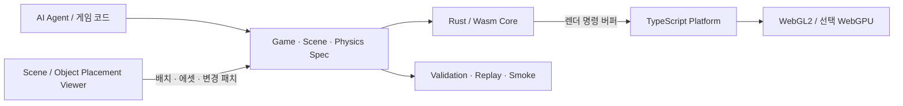

# Ferrum2D

**AI agent-first 2D · HD-2D 웹 게임 엔진**

Rust / WebAssembly로 게임을 실행하고, TypeScript와 WebGL2로 브라우저에 그립니다.
AI agent가 데이터와 코드를 수정하고, Scene/Object Placement Viewer에서 배치와 실행 결과를 확인합니다.

[시작하기](#시작하기) · [예제](#예제-갤러리) · [기능 안내](docs/engine/ai-feature-guide.md) · [문서](docs/README.md) · [GitHub Releases](https://github.com/silbaram/ferrum2d/releases)


*정적 3D 마을과 2D 캐릭터를 함께 배치하는 HD-2D 작업공간. 아래 이미지는 현재 개발 소스를 실제 브라우저에서 실행한 화면입니다.*

> **현재 상태:** MVP 개발 완료, 상용제품 기능 개발 중입니다. 저장소의 package version은 `0.1.0`이며,
> 개발 소스의 기능과 공개된 beta 패키지의 기능은 다를 수 있습니다. 설치 버전의 릴리스 노트와 문서를 함께 확인하세요.

## 예제 갤러리

| 2D 등불 정원 | HD-2D 중세 마을 |
| --- | --- |
|  |  |
| 타일·픽셀 캐릭터·등불·그림자. 바닥을 클릭해 이동하고 토큰을 수집합니다. | 정적 GLB 건물·입체 지형·2D 캐릭터. 높이·층·카메라·조명을 확인합니다. |

**Top-down Shooter** — 이동·조준·발사·적 생성·점수·게임 상태를 연결한 장르 예제입니다.


이미지는 합성 시안이 아닌 실제 WebGL2 실행 화면입니다. 정원·마을은 구도를 고정하기 위해 게임 미리보기를 일시정지해 캡처했습니다.
예제의 아트와 게임 구성은 엔진 API 위에 만든 콘텐츠입니다.
[캡처 환경과 재생성 방법](docs/development/quality/screenshots/README.md)을 참고하세요.

### 직접 실행하기

먼저 아래 [소스 개발환경](#소스-개발환경)을 준비하고 저장소 루트에서 실행합니다. 접속 주소와 포트는 Vite 터미널에 표시됩니다.

| 예제 | 실행 명령 / 열기 | 소스 위치 |
| --- | --- | --- |
| 2D 등불 정원 | `pnpm dev:placement-viewer` → `?scene=garden` | [앱](apps/placement-viewer/) · [씬 JSON](apps/placement-viewer/public/placement.garden.scene-authoring.json) |
| HD-2D 마을 | 같은 뷰어 → `?scene=village` | [씬 JSON](apps/placement-viewer/public/placement.village.scene-authoring.json) · [에셋](apps/placement-viewer/public/assets/rpg-village/) |
| Top-down Shooter | `pnpm dev:topdown` | [examples/topdown-shooter](examples/topdown-shooter/) |
| Starter Runtime | `pnpm dev:starter-runtime` | [examples/starter-runtime](examples/starter-runtime/) |
| Breakout | `pnpm dev:breakout` | [examples/breakout](examples/breakout/) |
| Platformer | `pnpm dev:platformer` | [examples/platformer](examples/platformer/) |
| Physics Sandbox | `pnpm dev:physics-sandbox` | [examples/physics-sandbox](examples/physics-sandbox/) |

- **정원:** 실행 버튼을 누른 뒤 바닥을 클릭합니다. 벽·건물·운하는 통과할 수 없고, 다리로 건넙니다. 정지는 원래 배치와 토큰을 복원합니다.
- **마을:** HD-2D에서 객체 배치와 편집 카메라를 확인하고, 게임 미리보기에서 씬에 저장된 게임 카메라 구도를 확인합니다.
- **Shooter:** Enter로 시작, WASD로 이동, 마우스로 조준, 왼쪽 클릭 또는 Space로 발사합니다. 게임 종료 후 Space로 재시작합니다.

뷰어의 게임 미리보기는 Scene Authoring 런타임을 실행합니다. 외부 게임 프로젝트의 임의 TypeScript 진입점이나 자체 HUD까지 자동으로 실행하지는 않습니다.
전체 예제와 기능의 연결은 [Showcase Hub](docs/engine/showcase-hub.md)에 정리되어 있습니다.

## 어떤 기능이 있나요?

| 영역 | 현재 개발 소스에서 제공하는 기능 | 자세히 보기 |
| --- | --- | --- |
| 런타임 | Rust/Wasm 업데이트, 엔티티·씬, bulk command buffer, snapshot·저장/복원 | [Core API](docs/engine/public-api/core.md) |
| 2D 렌더링 | WebGL2 sprite batch, atlas·tilemap, 레이어·깊이 정렬, 카메라, bitmap text, render texture | [Public API](docs/engine/public-api.md) |
| 픽셀 표현·조명 | 평면 2D 고정 해상도·정수 확대·레터박스, sprite normal map, 점광원·그림자·후처리 | [2D 표시 설정](docs/engine/data-scene-authoring.md) · [표현 효과](docs/engine/data-scene-presentation.md) |
| HD-2D | 정적 GLB/glTF, 지형·경사·높이·층, billboard, 공간 카메라·picking, 조명·그림자·안개·DOF, 선택 WebGPU 경로 | [공간 씬과 지원 범위](docs/engine/data-scene-spatial.md) |
| 게임플레이 | 선언형 씬·prefab, actor 이동·경로 탐색, animation, projectile·weapon, Behavior Recipe·FSM 실행 | [Data Scene](docs/engine/data-scene-authoring.md) · [Native Runtime](docs/engine/data-scene-native-runtime.md) |
| 물리·충돌 | AABB·원·다각형, raycast·shape cast, CCD, controller·platform, 공간 높이·층 연결 | [물리 기능 맵](docs/development/architecture/physics-engine.md) · [Physics Spec](docs/engine/physics-spec.md) |
| 입력·오디오 | action binding·context, 키보드·포인터·gamepad, 오디오 정책·공간 오디오 | [입력](docs/engine/input-actions.md) · [Core API](docs/engine/public-api/core.md) |
| 에셋 | atlas, 타일맵 가져오기, 병렬 로딩·취소, 선택 KTX2, 모델 캐시·스트리밍·GPU 자원 진단 | [에셋·플랫폼 API](docs/engine/public-api/core.md) |
| 배치·도트 보조 도구 | 프로젝트 씬 탐색, 다중 문서, 드래그 배치·변형·Undo, 레이어, 게임 카메라, 한국어/영문 UI, 도트 캔버스·팔레트·프레임 편집·노멀 생성, 디스크 에셋 사용처·정리 | [뷰어 사용법](apps/placement-viewer/README.md) |
| 검증 | spec validation, replay/hash, browser smoke, runtime budget·profiler, package·consumer smoke | [검증 기준](docs/development/quality/smoke-check.md) |

기능별 제약과 opt-in 조건은 각 문서를 기준으로 합니다. HD-2D는 정적 모델과 2D 게임을 위한 경로이며,
범용 3D 제작 도구나 스켈레탈 애니메이션을 제공하는 것은 아닙니다.

## 개발 흐름과 구조

기본 개발 흐름은 **AI agent가 spec·코드를 수정하고 검증하는 방식**입니다. 뷰어는 씬 배치·에셋·실행 결과를 확인하는 보조 도구입니다.



- **Rust:** 게임 상태, 시뮬레이션, 충돌, 씬 로직과 렌더 명령 생성을 담당합니다.
- **TypeScript:** 브라우저 API, 입력·오디오·에셋 로딩과 GPU 렌더링을 담당합니다.
- **Wasm 경계:** 객체마다 왕복 호출하지 않고 숫자 버퍼로 데이터를 묶어 전달합니다.
- **검증:** 화면 확인에 spec validation, replay와 성능 예산을 함께 사용합니다.

[아키텍처](docs/development/architecture/architecture.md)에서 책임 경계와 실행 흐름을 설명합니다.
Behavior Recipe 본문·FSM/action graph를 UI에서 작성하는 범용 visual editor, 멀티플레이어,
전체 게임 루프 Worker 이전·Wasm threads·복잡한 물리는 별도 설계와 승인 범위입니다.

### API 지원 수준

| import | 용도 |
| --- | --- |
| `@ferrum2d/ferrum-web/core` | 게임 실행과 플랫폼 API. 제품 계약의 중심입니다. |
| `@ferrum2d/ferrum-web/authoring` | 씬·prefab·Behavior Recipe 등 데이터 기반 authoring primitive입니다. |
| `@ferrum2d/ferrum-web/starter-scenes` | 생성 프로젝트와 검증에 사용하는 starter입니다. |
| `@ferrum2d/ferrum-web/labs` | 명시적 opt-in 또는 지원 환경이 필요한 확장 기능입니다. |
| `@ferrum2d/ferrum-web/quality` | smoke·report·runtime budget 검증 도구입니다. |

기존 root import는 호환용 aggregate입니다. 새 게임은 목적별 공개 subpath를 우선 사용합니다.
[API와 지원 수준](docs/engine/public-api.md), [이전 가이드](docs/engine/public-api/migration-guide.md)를 참고하세요.

## 시작하기

### 게임 프로젝트에서 사용하기

Node.js 22를 권장합니다. 배포된 엔진을 사용하는 게임 프로젝트에는 Rust 빌드가 필요하지 않습니다.

**AI에게 설치를 맡길 때:** [AI 에이전트용 설치 지침](docs/engine/ai-agent-install.md)을 전달합니다.
이 경로는 문서에 고정된 릴리스의 엔진·도구·AI 지침을 설치하고 환경을 검증합니다. 게임 코드는 개발을 요청한 뒤 작성합니다.

**실행 가능한 템플릿으로 시작할 때:** [GitHub Releases](https://github.com/silbaram/ferrum2d/releases)에서
선택한 버전의 `ferrum2d-create-game-<버전>.tgz` 다운로드 링크를 복사합니다.

```bash
ferrum_cli_url="<선택한 GitHub Release의 create-game .tgz 다운로드 URL>"
npx --yes --allow-remote=root "$ferrum_cli_url" my-game
cd my-game
npm install
npm run dev
```

이 경로는 예제 게임 코드가 포함된 starter를 생성합니다. AI 지침은 생성 프로젝트에서 `npm run ferrum:agents`로 명시적으로 설치합니다.
GitHub Release의 패키지 설치가 기준이며, npm registry에 같은 버전이 있다고 가정하지 않습니다.

| 배포 패키지 | 역할 |
| --- | --- |
| `@ferrum2d/ferrum-web` | Rust/Wasm 엔진과 브라우저 런타임 |
| `@ferrum2d/authoring-viewer` | 배치·에셋·handoff를 위한 공유 authoring helper |
| `@ferrum2d/create-game` | 게임 프로젝트 생성 CLI |
| `@ferrum2d/agents` | 게임 프로젝트용 agent·skill·command 설치 CLI |

전체 Placement Viewer 데스크톱 앱은 helper `.tgz`와 별개입니다. 설치 파일에는 미리보기 엔진이 포함됩니다.
OS별 설치 파일의 제공 여부는 선택한 릴리스의 첨부 파일을 확인하세요.
[엔진·뷰어 분리 배포](docs/development/operations/github-release.md)를 참고하세요.

### 소스 개발환경

필수 도구는 Rust stable, `wasm32-unknown-unknown`, `wasm-pack`, Node.js와 pnpm입니다. Node.js 22와 pnpm 10.8.0을 권장합니다.

```bash
git clone https://github.com/silbaram/ferrum2d.git
cd ferrum2d

rustup default stable
rustup target add wasm32-unknown-unknown
cargo install wasm-pack

corepack enable
corepack prepare pnpm@10.8.0 --activate
pnpm install
pnpm build

pnpm dev:placement-viewer
# 터미널에 표시된 주소에 ?scene=garden 또는 ?scene=village 추가
```

`pnpm build`는 Wasm과 workspace 패키지·앱·예제를 빌드합니다.
Wasm target 오류가 나면 `which rustc`, `rustup which rustc`, `rustup target list --installed`로 rustup 도구가 사용되는지 확인하세요.

수정 중인 엔진을 외부 게임 프로젝트에 적용할 때는 다음 명령을 사용합니다.

```bash
pnpm engine:local --project /path/to/my-game
```

빌드·패키징·설치·검증과 실패 복원 범위는 [로컬 엔진 설치](docs/development/operations/local-engine-install.md)에 설명되어 있습니다.

## 검증하기

```bash
pnpm lint
pnpm test                          # TypeScript + Rust
pnpm build                         # Wasm + workspace
pnpm validate:docs-links
pnpm validate:public-api-surface
```

배치/뷰어를 변경했다면 `pnpm smoke:placement-viewer`, 평면 픽셀 표시를 변경했다면 `pnpm smoke:flat-pixel-perfect`를 실행합니다.
패키지 변경은 `pnpm package:check`, 생성 프로젝트 변경은 `pnpm package:consumer-smoke`로 검증합니다.
전체 회귀 묶음은 `pnpm smoke:check`이며, 기능별 명령과 통과 조건은 [Smoke Check](docs/development/quality/smoke-check.md)를 따릅니다.

문서·데모의 정적 사이트는 `pnpm build:pages`와 `pnpm validate:pages-artifact`로 로컬 검증합니다.
현재 CI와 Pages 워크플로는 GitHub Actions의 `workflow_dispatch`로 수동 실행합니다.
[Pages 운영](docs/development/operations/demo-deploy.md) · [릴리스 운영](docs/development/operations/github-release.md)

## 저장소 안내

```text
crates/ferrum-core/             Rust 게임 시뮬레이션 · Wasm
packages/ferrum-web/            TypeScript 브라우저 런타임
packages/ferrum-authoring-viewer/ 공유 authoring helper
packages/create-game/          게임 프로젝트 생성 CLI
packages/agents/               게임 개발용 AI 지침
apps/placement-viewer/         웹 Scene/Object Placement Viewer
apps/placement-viewer-desktop/ 데스크톱 앱
examples/                      장르별 런타임 예제
docs/                          사용법 · 설계 · 검증 · 개발계획
scripts/                       빌드 · 검증 · 배포 준비 도구
```

| 목적 | 문서 |
| --- | --- |
| 처음 시작 | [개발자 퀵스타트](docs/engine/developer-quickstart.md) · [사용자 가이드](docs/engine/user-guide.md) |
| AI로 게임 개발 | [설치 지침](docs/engine/ai-agent-install.md) · [기능 안내](docs/engine/ai-feature-guide.md) |
| 기능과 예제 둘러보기 | [Showcase Hub](docs/engine/showcase-hub.md) |
| 씬·오브젝트·카메라 | [Data Scene Authoring](docs/engine/data-scene-authoring.md) · [HD-2D](docs/engine/data-scene-spatial.md) · [뷰어 안내](apps/placement-viewer/README.md) |
| API·호환성 | [Public API](docs/engine/public-api.md) · [Migration Guide](docs/engine/public-api/migration-guide.md) |
| 전체 문서·변경 이력 | [문서 목차](docs/README.md) · [CHANGELOG](CHANGELOG.md) |

## License

`MIT OR Apache-2.0` 듀얼 라이선스입니다. [LICENSE](LICENSE)를 확인하세요.
