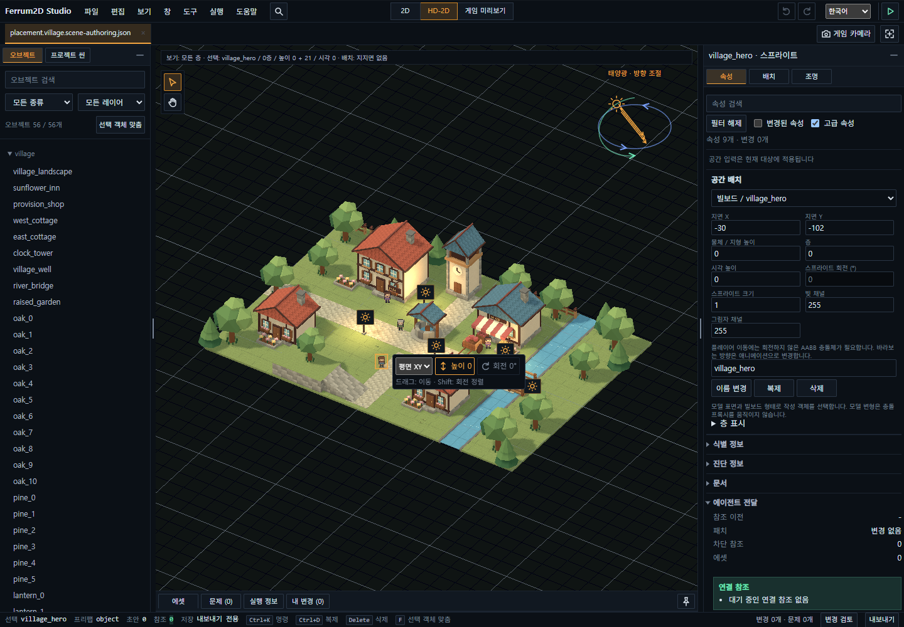

# Ferrum2D Documentation

[한국어](../README.md) · English

Ferrum2D is an **AI agent-first 2D and HD-2D web game engine** built with Rust, WebAssembly, and TypeScript.
Agents edit specifications and code; the Scene/Object Placement Viewer helps people inspect assets, placement, and runtime results.

These guides describe the current development source. Released packages can provide a different feature set.
For a game project, check the types, release notes, and documentation for its installed version.

## Start here

| Goal | Guide |
| --- | --- |
| Understand the engine, run examples, and learn what the viewer saves | [User Guide](engine/user-guide.md) |
| Try individual engine features in a browser | [Feature and Example Guide](engine/showcase-hub.md) |
| Create and validate a game project | [Developer Quickstart](engine/developer-quickstart.md) |
| Choose supported imports and understand compatibility | [Public API](engine/public-api.md) |

The [public demo site](https://silbaram.github.io/ferrum2d/) contains 26 independent feature experiments,
integrated games, and the placement viewer. Demo controls may be in Korean; the placement viewer has its own English/Korean language setting.
Changing documentation language does not change the language of a running demo.

This is a real browser capture of the viewer. It shows example content built on the engine APIs.

## English coverage and detailed references

The English set currently covers the documentation index, user guide, quickstart, feature guide, and public API overview.
Detailed references below are in Korean and are labeled accordingly. Use them for precise field limits, storage formats, and capability requirements.

| Topic | Reference |
| --- | --- |
| AI setup without generating a game | [AI Agent Installation (Korean)](../engine/ai-agent-install.md) |
| Scene composition, placement, pixel editing, and asset workflows | [Scene Authoring (Korean)](../engine/data-scene-authoring.md) |
| Terrain, floors, static models, cameras, lighting, and shadows | [HD-2D Spatial Scenes (Korean)](../engine/data-scene-spatial.md) |
| Animation and presentation | [Presentation (Korean)](../engine/data-scene-presentation.md) |
| Movement, navigation, and native gameplay | [Native Runtime (Korean)](../engine/data-scene-native-runtime.md) |
| Physics configuration and solver contracts | [Physics Spec (Korean)](../engine/physics-spec.md) |
| Rust/TypeScript ownership and Wasm boundaries | [Architecture (Korean)](../development/architecture/architecture.md) |
| Regression checks, browser tests, and runtime budgets | [Smoke Check (Korean)](../development/quality/smoke-check.md) |
| Building and publishing this site | [Pages Operations (Korean)](../development/operations/demo-deploy.md) |
| Work in progress and proposals | [Planning (Korean)](../planning/README.md) |

## How the documentation is maintained

- Korean documents remain at their existing paths; English guides use `docs/en/` with matching filenames.
- Paired pages link to each other on GitHub and in the Pages language switcher.
- A page without an English counterpart links to the English documentation index; it does not imply that the page has been translated.
- Both languages describe verified behavior. Proposals belong in planning documents and are not presented as supported features.
- `dist-pages/` is generated output. Edit the Markdown sources and rebuild the site.
