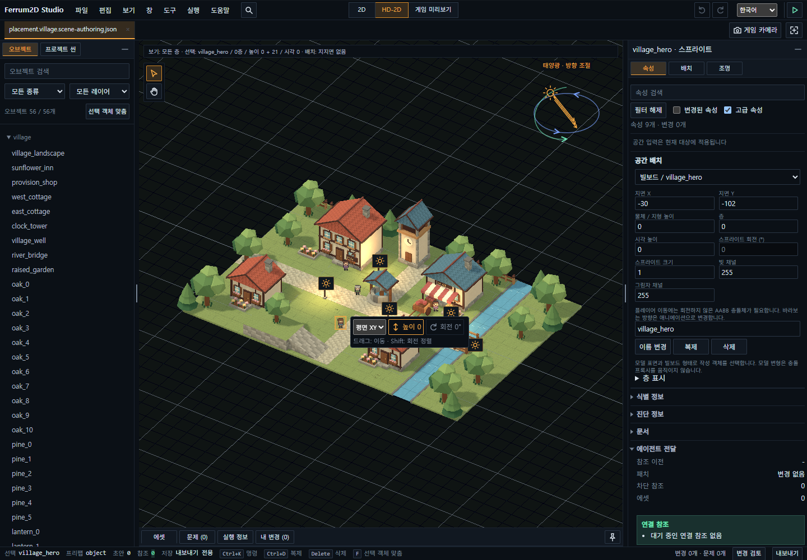

# Ferrum2D Simple User Guide

[한국어](../../engine/user-guide.md) · English

Ferrum2D makes **2D and HD-2D games that run in a browser**.
You can build pixel games or combine 2D characters with terrain and static models.
An AI agent can implement game features while you review the result in the browser and adjust scenes in **Ferrum2D Studio**.

## Try it without installing

[Open the Feature Lab](https://silbaram.github.io/ferrum2d/starter-runtime/).
Choose lighting, physics, cameras, or animation. Follow the on-screen actions and compare the result as you change settings.
Use the example switcher to try the shooter, platformer, or Breakout.
[Explore Features and Examples](showcase-hub.md) provides direct links. Some demo controls are in Korean.

## Edit and play in Studio

Studio lets you arrange objects, adjust their size and lighting, work with assets, and preview a scene.
Start by [opening the HD-2D village](https://silbaram.github.io/ferrum2d/studio/?scene=village).



Objects are listed on the left, the scene is in the middle, and the selected object's settings are on the right.
This is a saved capture of the real example with Korean UI. Layout and labels can vary by version.
Studio has its own Korean/English language selector.

1. Select a tree, character, or other object in the list or scene. Its settings appear on the right.
2. Drag the selected object to move it. Use the undo button if needed.
3. Open **Game Preview** to see the scene through the game camera.
4. Press **Play** to run the scene. **Stop** returns to your editing state.
5. Review **My Changes**, then save or export the scene.

Open other examples from **File → Examples**. Compare the 2D garden with the HD-2D village.
Use the game camera settings to change the game's view; moving the editing camera is a separate action.

### Where are changes saved?

| Environment | Saving |
| --- | --- |
| Examples on the website | Export a file. The website's original example is not overwritten. |
| Local development server | Direct saving is available only when enabled for the project. Check the displayed save status. |
| Desktop Studio | Save supported documents and assets in the project you opened. |

Keep exported files somewhere you can find them. A **handoff** contains editing context for an agent; it is separate from saving the scene itself.
Studio previews scene behavior. Run the game project to check its custom game screen and menus.

## Start your own game

Follow [Run Your First Game](developer-quickstart.md), or give an agent your project folder and
[AI Game Development](ai-game-development.md), along with a request such as:

```text
Create a small Ferrum2D top-down shooter in this folder.
Use keyboard movement and mouse aiming.
When finished, tell me how to run it and which controls to check.
```

For an existing game, describe the result you want:

```text
Make the character move a little faster and increase the time between early enemy spawns.
Validate the change and tell me which settings changed.
```

Play the result and review movement, difficulty, lighting, and sound before choosing the next change.
Use the [shared references](../README.md#shared-detailed-references) when you want exact settings or APIs.

## Common problems

| Situation | First check |
| --- | --- |
| The game does not open | Keep the development server running and open the URL printed in its terminal. |
| No audio | Click the game or press Start, then check volume. |
| Studio cannot save | Check whether the document is export only. |
| A Studio edit does not appear in the game | Save/export the scene and ask the agent to verify that the game actually loads that file. |
| A documented menu is missing | Check your release's instructions; the website and development source may be newer. |

Studio supports scene and asset editing and preview. Agents implement game rules through settings and code.
For more controls, see the [detailed Studio guide (Korean)](https://github.com/silbaram/ferrum2d/blob/main/apps/studio/README.md).
