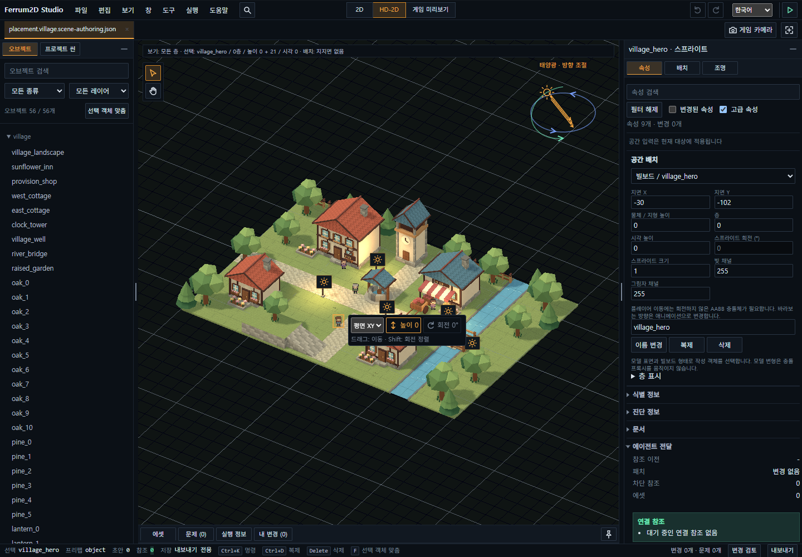

# Ferrum2D 간단 사용법

한국어 · [English](../en/engine/user-guide.md)

Ferrum2D는 브라우저에서 실행하는 **2D·HD-2D 게임을 만드는 엔진**입니다.
도트 게임부터 입체 지형과 2D 캐릭터를 조합한 장면까지 만들 수 있습니다.
AI에게 게임 기능을 맡기고, 사람은 브라우저와 **Ferrum2D Studio**에서 결과를 확인하고 씬을 손볼 수 있습니다.

## 설치 없이 먼저 둘러보기

[기능 실험실 열기](https://silbaram.github.io/ferrum2d/starter-runtime/)

조명·물리·카메라·애니메이션 중 관심 있는 주제를 고르세요.
화면의 **직접 해보기** 안내에 따라 값을 바꾸면 **관찰할 결과**에서 차이를 확인할 수 있습니다.
게임 형태로 보고 싶다면 상단 **예제 이동**에서 슈터·플랫포머·벽돌깨기를 선택하세요.
[기능과 예제 둘러보기](showcase-hub.md)에 바로 가는 링크가 있습니다.

## Studio에서 씬을 바꿔보기

Studio는 오브젝트의 위치·크기·조명과 에셋을 작성하고 장면을 실행해 보는 도구입니다.
**[Studio의 HD-2D 마을 열기](https://silbaram.github.io/ferrum2d/studio/?scene=village)**로 시작하세요.



왼쪽은 오브젝트 목록, 가운데는 장면, 오른쪽은 선택한 오브젝트의 설정입니다.
위 이미지는 저장소에 보관한 실제 예제 화면이며, 설치 버전에 따라 배치나 표시가 다를 수 있습니다.

1. 왼쪽 목록이나 장면에서 나무·캐릭터 같은 오브젝트를 선택합니다. 오른쪽에 선택한 대상의 설정이 나타납니다.
2. 선택한 오브젝트를 드래그해 옮깁니다. 실수했다면 상단 실행 취소 버튼으로 되돌립니다.
3. **게임 미리보기**를 눌러 실제 게임 카메라에서 어떻게 보이는지 확인합니다.
4. **실행**을 눌러 장면을 플레이합니다. **정지**하면 편집하던 장면으로 돌아옵니다.
5. **내 변경**에서 바뀐 내용을 확인하고 저장하거나 내보냅니다.

다른 예제는 **파일 → 예제**에서 엽니다. 2D 장면은 **등불 정원**, 입체 장면은 **마을**로 비교할 수 있습니다.
게임에서 사용할 카메라는 **게임 카메라** 설정으로 조정합니다. 편집 화면에서 둘러본 구도와는 별개입니다.

### 저장은 어디에 되나요?

| 사용 환경 | 저장 방식 |
| --- | --- |
| 웹사이트의 예제 | 파일로 내보냅니다. 웹의 원본 예제를 덮어쓰지 않습니다. |
| 로컬 개발 서버 | 저장 기능을 켠 프로젝트에서만 직접 저장할 수 있습니다. 화면의 저장 상태를 확인하세요. |
| 데스크톱 Studio | 연 프로젝트의 지원 문서와 에셋을 저장합니다. |

내보낸 파일은 따로 보관하세요. AI에게 전달하는 **handoff**는 편집 내용과 참고 정보를 담은 자료로, 씬 파일 저장과는 별도입니다.
Studio는 씬의 동작을 미리 보여줍니다. 프로젝트에서 별도로 작성한 게임 화면·메뉴까지 확인하려면 그 프로젝트를 실행하세요.

## 내 게임을 시작하려면

직접 설치하려면 [첫 게임 실행하기](developer-quickstart.md)를 따라 하세요.
AI에게 맡긴다면 프로젝트 폴더와 만들고 싶은 게임을 알려주고 [AI 게임 개발 안내](ai-game-development.md)를 전달하세요.

```text
이 폴더에 Ferrum2D로 간단한 탑다운 슈팅 게임을 만들어줘.
키보드로 이동하고 마우스로 조준하게 해줘.
완료되면 실행 방법과 확인할 조작을 알려줘.
```

게임이 만들어진 뒤에는 원하는 결과를 구체적으로 요청하면 됩니다.

```text
캐릭터 이동 속도를 조금 높이고, 초반 적이 나오는 간격을 늘려줘.
수정 후 검증하고 어떤 값이 바뀌었는지 알려줘.
```

사람은 실행 화면에서 이동·난이도·조명·소리를 확인하고 다음 변경을 정합니다.
설정값이나 코드가 궁금할 때만 [상세 참조](../README.md#공통-상세-참조)를 찾아보세요.

## 자주 막히는 부분

| 상황 | 먼저 확인할 것 |
| --- | --- |
| 게임 화면이 열리지 않음 | 개발 서버가 실행 중인지, 터미널에 표시된 주소를 열었는지 확인 |
| 소리가 나지 않음 | 화면을 클릭하거나 시작 버튼을 누른 뒤 음량 확인 |
| Studio의 저장 버튼이 비활성 | 내보내기 전용인지 화면의 저장 상태 확인 |
| Studio에서 바꿨는데 게임에 반영되지 않음 | 씬을 저장/내보냈는지 확인하고, AI에게 해당 씬 파일이 실제 게임에 연결됐는지 점검 요청 |
| 문서에 있는 메뉴가 없음 | 설치한 릴리스의 안내 확인. 웹 예제와 개발 소스가 더 새로울 수 있음 |

현재 Studio는 씬·에셋 작성과 미리보기를 지원합니다. 복잡한 게임 규칙은 AI가 설정과 코드로 작성합니다.
추가 조작은 [Studio 상세 안내](https://github.com/silbaram/ferrum2d/blob/main/apps/studio/README.md)를 참고하세요.
