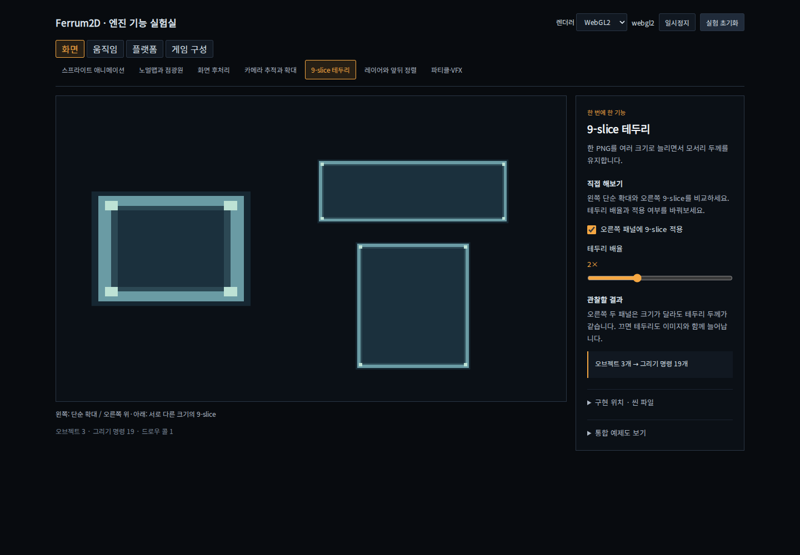

# Ferrum2D 예제 안내

엔진 기능을 하나씩 체험하려면 **Starter Runtime의 기능 실험실**부터 연다.
기능을 선택하면 해당 기능만 있는 씬, 조작 방법, 관찰할 결과, API 이름과 씬 JSON이 나온다.
점수나 수집 미션을 완료할 필요가 없다.



```bash
pnpm dev:starter-runtime
```

터미널의 주소를 열고 상단에서 주제를 선택한다. 각 기능은 `?feature=<id>`로 바로 열 수 있다.

| 기능 | id | 직접 바꾸는 항목 |
| --- | --- | --- |
| 스프라이트 애니메이션 | `animation` | 속도·정방향/역방향/왕복·좌우 반전 |
| 길 찾기와 장애물 | `navigation` | 목적지·키보드/포인터 이동 |
| 물리 재질과 반사 | `physics` | 고무/점토·같은 초기 힘으로 던지기 |
| 노멀맵과 점광원 | `lighting` | 광원 위치·조명/원본·노멀 적용 |
| 화면 후처리 | `postprocess` | 원본/bloom/CRT |
| 카메라 추적과 확대 | `camera` | 고정/추적·배율·이동 목적지 |
| 9-slice | `nine-slice` | 단순 확대와 비교·적용 여부·테두리 배율 |
| 타일맵과 타일 충돌 | `tilemap` | 벽/바닥 브러시·통로 열기/닫기·실제 통과 |
| 레이어와 앞뒤 정렬 | `layers` | 로봇의 그리기 순서·겹친 부분 비교 |
| 파티클·VFX | `particles` | 불꽃/먼지/잔상·수량/수명/속도·방출/정지 |
| 공간 오디오 | `audio` | 재생/정지·좌우 위치/거리/볼륨 |
| 입력 장치와 메뉴 전환 | `input` | 키보드/게임패드/가상 조이스틱·메뉴 입력 차단 |
| 씬 전환과 페이드 | `scenes` | A/B 왕복·씬/전역 카운터·전환 중 pause |
| 상호작용과 트리거 | `interaction` | 거리·스위치 조건·문 사용·구역 출입 |
| 저장과 불러오기 | `save-load` | 위치·수집 진행 저장/복원·전용 슬롯 삭제 |
| 대화와 퀘스트 | `dialogue` | 수락/거절·소포 조건·목표 완료 |
| HUD·다국어·접근성 | `hud` | 체력·한국어/영어·글자 크기·대비 |
| 사격과 벽 충돌 | `projectiles` | 일반·벽 관통·반사, 동일 속도 한 발 비교 |
| 컷신과 동작 감소 | `cutscene` | 카메라·자막·효과음, 건너뛰기·동작 감소 |
| 에셋 로딩과 캐시 | `asset-loading` | 실제 fetch·메모리 캐시, 취소·실패·재시도 |
| 레벨 스트리밍 | `streaming` | 구역 로드·전용 텍스처 해제·공통 자산 유지 |

## 기존 예제에서 더 살펴보기

| 디렉터리 | 주제 | 실행 |
| --- | --- | --- |
| [starter-runtime](starter-runtime/README.md) | 위의 독립 실험 21종. `?mode=starter`는 사격 프로필/리플레이, `?mode=playground`는 이전 통합 게임 | `pnpm dev:starter-runtime` |
| [physics-sandbox](physics-sandbox/README.md) | rigid body, collider, contact/sensor, joint, CCD, platformer physics, scene query 7개 시나리오 | `pnpm dev:physics-sandbox` |
| [platformer](platformer/README.md) | 점프·착지·단방향 발판·이동 발판. 기능 선택 후 해당 위치로 이동 | `pnpm dev:platformer` |
| [breakout](breakout/README.md) | 반사·충돌 이벤트·파티클. 관찰 항목과 충돌 영역 표시 | `pnpm dev:breakout` |
| [topdown-shooter](topdown-shooter/README.md) | Game Spec·타일 충돌·웨이브·오디오를 연결한 통합 게임 | `pnpm dev:topdown` |
| [pixel-art](pixel-art/README.md) | 도트 원본·팔레트·정수 배율을 연결한 정원 통합 예제 | `pnpm dev:pixel-art` |
| [minimal-game](minimal-game/README.md) | 최소 bootstrap 소스와 회귀용 visual/input/UI fixture | `pnpm dev:minimal` |

각 명령은 개별 Vite 서버다. 다른 예제를 열 때는 해당 명령의 터미널 주소를 사용한다.
하나의 사이트에서 모두 탐색하려면 `pnpm build && pnpm build:pages` 후
`pnpm preview:examples --host 127.0.0.1`로 열면 된다.
로컬 빌드는 GitHub Pages 원격 배포를 실행하지 않는다.

`shared/`는 공통 화면과 안내이며 별도 실행 예제가 아니다.
에디터 예제는 `apps/placement-viewer/`에 있다.
